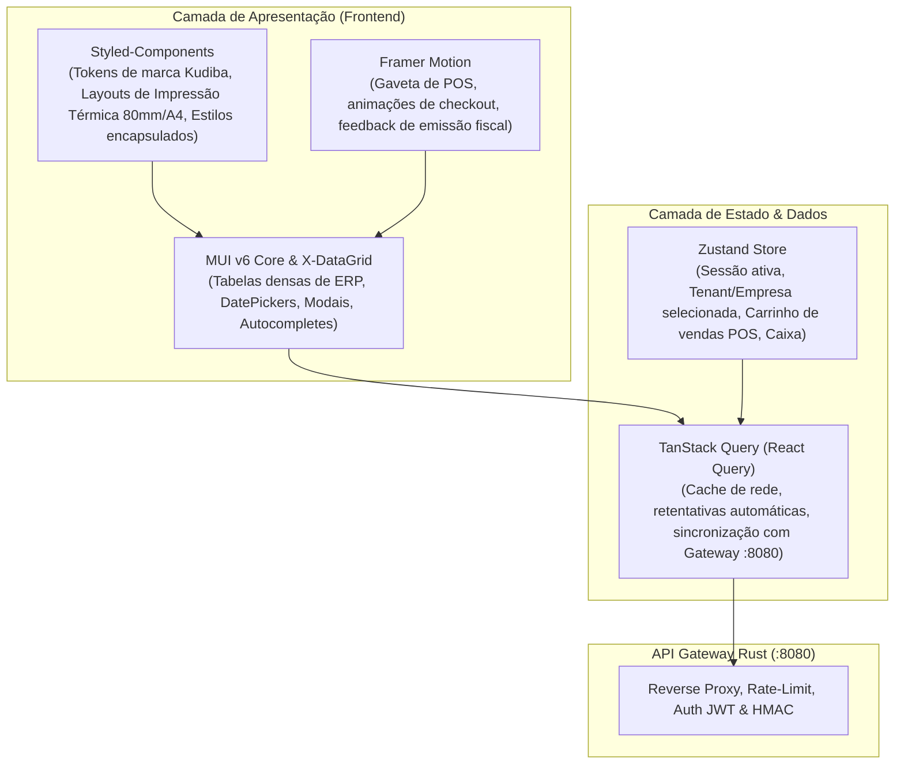

# 🎨 Plano de Arquitetura & Interfaces de Utilizador (UI/UX) — Kudiba ERP

> **Localização:** `Frontend/docs/PLANO_ARQUITETURA_UI.md`  
> **Stack Base:** React 18/19 + Vite + TypeScript  
> **Bibliotecas Centrais de UI:** MUI v6 (Componentes Corporativos densos), Styled-Components (Theming & Impressão Fiscal), Framer Motion (Micro-interações), TanStack Query v5 e Zustand.

---

## 1. Visão Geral & Coexistência das Tecnologias

### Divisão de Responsabilidades Técnicas
1. **MUI (Material UI v6)**:
   - Fornece componentes de controle de formulários, grelhas densas de dados (`DataGrid` com paginação no servidor), modais de confirmação, inputs monetários com máscara e datepickers.
2. **Styled-Components**:
   - Define a identidade visual corporativa do **Kudiba** (paleta esmeralda e ouro, liquid glass).
   - Estilos dedicados para impressão `@media print` de tickets térmicos de 80mm/58mm e folhas A4 homologadas pela AGT.
3. **Framer Motion**:
   - Transições de rota suaves sem repinturas desnecessárias.
   - Gaveta retrátil do carrinho de compras e atalhos rápidos do POS.
   - Toasts e alertas animados de estado fiscal e contingência.

---

## 2. Especificação dos 8 Módulos Funcionais da UI

1. **Autenticação & Multi-Tenant Switcher:** Login corporativo com JWT, seleção dinâmica de organização/loja e status de conexão perimétrica com o Gateway.
2. **Dashboard Executivo:** Métricas agregadas em tempo real de faturamento em Kwanzas (Kz), cobranças, faturas pendentes e integridade criptográfica AGT (RSA-SHA1).
3. **Ponto de Venda (POS / Caixa Rápido):** Ecrã otimizado para teclado (F1-F12), leitor de código de barras, carrinho em tempo real e emissão instantânea de Faturas-Recibos (FR).
4. **Faturação & Gestão Fiscal (AGT):** Emissão de FT, FR, FP, NC e ND com cálculo automático de IVA (14%/5%/0%) e retenções na fonte (6,5%).
5. **Inventário & Armazéns:** Controlo de stocks, valorização patrimonial por Custo Médio Ponderado (CMP) e múltiplos depósitos.
6. **Tesouraria & Contas a Receber:** Sessões de caixa (Fecho X cego e Fecho Z fiscal), liquidação de faturas e emissão de Recibos RC.
7. **Recursos Humanos & Folha Salarial (KudibaPayroll):** Gestão de colaboradores, apuramento de IRT pelos escalões de Angola e Segurança Social (INSS 3% e 8%).
8. **Configurações & Auditoria Fiscal:** Gestão de chaves criptográficas RSA, registo do software na AGT e exportação do ficheiro SAF-T (AO) XML.
