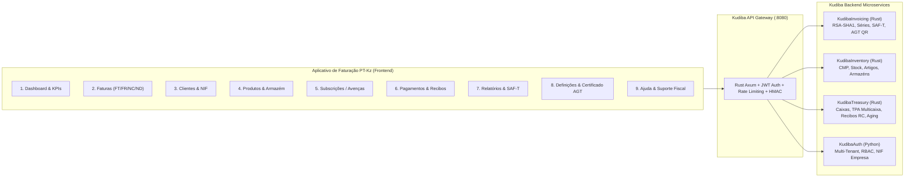

# 📄 Aplicativo de Faturação Kudiba (PT-Kz) — Especificação Funcional & Mapeamento Backend

> **Referência:** Documento de Especificação Funcional e Interfaces em Kwanza (Kz / AOA)  
> **Conformidade Legal:** Decreto Presidencial n.º 71/25 e Decreto Executivo n.º 385/20 da Administração Geral Tributária (AGT) da República de Angola.  
> **Arquitetura Base:** Microserviços Rust (Gateway, Faturação, Inventário, Tesouraria) + Python/FastAPI (Autenticação, RH/Payroll, Integrações).

---

## 🏛️ 1. Visão Geral da Solução

O **Aplicativo de Faturação Kudiba (PT-Kz)** é a interface de gestão comercial, faturação certificada e tesouraria desenhada especificamente para as empresas angolanas. Cada ecrã da aplicação está diretamente ancorado nas entidades, regras fiscais e microsserviços do backend do ecossistema Kudiba:

---

## 📊 Ecrã 1: Dashboard (Resumo Geral da Faturação)

### 1.1 Objetivo & Conceito
Oferecer à administração e aos gestores financeiros uma visão clara e consolidada da receita em Kwanzas (Kz), cobranças realizadas, valores pendentes e saúde do cumprimento tributário.

### 1.2 Layout & Componentes de Ecrã
* **Cabeçalho:** Seletor de Estabelecimento/Loja, Pesquisa rápida (`⌘K`), Perfil do Operador, Seletor de Período temporal (`Este Mês: Out 1 – Out 31, 2026`), Botão de Ação Primária `[+ Criar Fatura]` e Botão Secundário `[Exportar]`.
* **Cartões de Indicadores Chave (KPIs em Kwanza):**
  * **Receita Total Faturada:** `128.450.000,00 Kz` (`+12.8% vs. mês passado`).
  * **Coletado / Liquidado:** `96.320.000,00 Kz` (`+8.2% vs. mês passado`).
  * **Atrasado / A Cobrar:** `32.130.000,00 Kz` (24 faturas a aguardar pagamento).
  * **Vencido em Risco:** `8.240.000,00 Kz` (6 faturas com vencimento ultrapassado).
* **Gráficos e Métricas Visuais:**
  * **Tendência de Receita:** Comparativo diário da receita faturada vs. mês anterior.
  * **Saúde da Coleção (Taxa de Cobrança):** `75.0%` da receita faturada já arrecadada em tesouraria (`96.320.000 Kz` Não Vencido / Liquidado vs `23.890.000 Kz` Vencido).
  * **Painel de Monitorização Fiscal AGT:**
    * Status da Cadeia Criptográfica: `Normal (Hash J-1 validado)`.
    * Último Documento Assinado: `FT 2026/00148`.
    * SAF-T (AO) do Mês: `Pronto para Envio (0 anomalias detetadas)`.

### 1.3 Mapeamento com o Kudiba Backend
* **Serviços Envolvidos:** `KudibaInvoicing` + `KudibaTreasury`.
* **Endpoints do Gateway:**
  * `GET /api/v1/invoicing/dashboard/summary?period=current_month`
  * `GET /api/v1/treasury/dashboard/aging-overview`
* **Entidades de Dados:** `invoices`, `invoice_receivables`, `payments`, `cash_sessions`.

---

## 📑 Ecrã 2: Faturas & Documentos Comerciais (Invoices)

### 2.1 Objetivo & Conceito
Centralizar o ciclo de vida completo dos documentos de faturação exigidos pela legislação fiscal angolana (Regulamento das Faturas e Documentos Equivalentes).

### 2.2 Tipologias de Documentos Suportadas
* **FT (Fatura):** Venda de bens ou prestação de serviços a prazo (gera automaticamente conta a receber em `KudibaTreasury`).
* **FR (Fatura-Recibo):** Venda a pronto pagamento (liquidação imediata em caixa ou TPA).
* **FP (Fatura Proforma):** Orçamento comercial sem valor fiscal (não movimenta stock nem contabilidade).
* **NC (Nota de Crédito):** Anulação total ou parcial de fatura emitida (retificação fiscal obrigatória, nos termos do Código do IVA).
* **ND (Nota de Débito):** Acréscimo de valor ou encargos a uma fatura anterior.

### 2.3 Estrutura da Tabela de Faturas
* **Abas de Filtragem Rápida:** `Todas as Faturas (148)` | `Pagas (118)` | `Pendentes (24)` | `Vencidas (6)` | `Rascunhos (12)`.
* **Colunas de Dados:**
  * `Nº Documento`: Série/Ano/Número (ex: `FT FT2026/00142`).
  * `Cliente`: Razão Social + NIF de Angola (ex: `Sonangol EP - 5401000000`).
  * `Data de Emissão`: Timestamp registado na assinatura fiscal.
  * `Data de Vencimento`: Limite para cobrança.
  * `Total Ilíquido`: Soma das linhas antes de imposto.
  * `IVA (14% / 5% / 0%)`: Montante de IVA discriminado.
  * `Retenção na Fonte (6,5%)`: Retenção de prestação de serviços deduzida ao total.
  * `Total Líquido a Pagar`: Valor final em Kwanzas (Kz).
  * `Estado Fiscal`: `Emitida / Selada`, `Paga`, `Pendente`, `Anulada`.
  * `Ações Rápidas`: `[Ver Detalhes]`, `[Descarregar PDF A4/Térmica]`, `[Enviar por E-mail]`, `[Emitir Recibo RC]`, `[Anular via NC]`.

### 2.4 Requisitos Criptográficos AGT (KudibaInvoicing)
* **Assinatura RSA-SHA1:** Gerada com a chave privada de 1024/2048 bits do contribuinte.
* **Encadeamento Criptográfico:** A assinatura do documento $N$ incorpora os primeiros 4 caracteres do hash do documento $N-1$.
* **QR Code AGT:** Impresso no rodapé conforme a especificação técnica: `A:NIF*B:NIF_CLIENTE*C:PAIS*D:TIPO*E:ESTADO*F:DATA*G:DOC*H:HASH*I:TOTAL*J:IVA*K:RETENCAO`.

---

## 👥 Ecrã 3: Clientes & Entidades Fiscais (Customers)

### 3.1 Objetivo & Conceito
Gestão de clientes com validação rigorosa de dados tributários angolanos, controlo de limites de crédito e histórico de dívidas.

### 3.2 Indicadores do Módulo
* **Total de Clientes Registados:** `420 Clientes`.
* **Clientes com Saldo Pendente:** `38 Clientes`.
* **Faturação Média por Cliente:** `305.800,00 Kz`.

### 3.3 Campos da Ficha do Cliente
* **Dados Fiscais:**
  * **NIF de Angola:** Validação automática de 10 dígitos (Pessoa Coletiva iniciada por 54... ou Particular com NIF de Bilhete de Identidade).
  * **Regime de IVA do Cliente:** `Regime Geral (14%)`, `Regime Simplificado (7%)` ou `Regime de Exclusão / Isento (Art. 12º CIVA)`.
  * **Retenção na Fonte de IVA:** Flag indicando se é Grande Contribuinte sujeito a cativar 50% do IVA ou Estado cativando 100%.
* **Dados Comerciais & Cobrança:**
  * Nome / Firma Comercial.
  * Morada Fiscal, Província (Luanda, Benguela, Huíla, etc.) e Município.
  * Contactos: E-mail para envio de faturas e Telefone angolano (`+244 9xx xxx xxx`).
  * Limite de Crédito Autorizado em Kz e Prazo Padrão de Pagamento (Pronto, 15 dias, 30 dias, 60 dias).
  * Saldo em Aberto e Extrato de Conta Corrente.

### 3.4 Mapeamento Backend
* **Serviços:** `KudibaInvoicing` e `KudibaTreasury` (`invoice_receivables`).
* **Endpoints:**
  * `POST /api/v1/invoicing/customers` (Criação com validação de NIF).
  * `GET /api/v1/treasury/customers/{id}/statement` (Extrato e faturas pendentes).

---

## 📦 Ecrã 4: Catálogo de Artigos, Produtos & Serviços (Products)

### 4.1 Objetivo & Conceito
Catálogo unificado para bens físicos sujeitos a controlo de stock e serviços sujeitos a impostos e retenções fiscais.

### 4.2 Indicadores do Módulo
* **Artigos Ativos no Catálogo:** `1.240 Artigos`.
* **Valor Patrimonial em Stock:** `48.200.000,00 Kz` (avaliado a Custo Médio Ponderado - CMP).
* **Artigos em Rutura / Stock Mínimo:** `14 Artigos`.

### 4.3 Campos e Categorização do Artigo
* **Tipo de Artigo:**
  * `BEM (Produto Físico)`: Movimenta stock, exige seleção de armazém, calcula CMP em tempo real via `KudibaInventory`.
  * `SERVIÇO (Prestação de Serviços)`: Não movimenta stock físico; sujeito a retenção na fonte de 6,5% para sujeitos passivos de IRC/IRT.
* **Preçário & Custos:**
  * Preço de Venda ao Público (PVP em Kz, com ou sem IVA).
  * Preço de Custo / CMP atualizado em Kwanzas.
* **Tributação de IVA (Regras AGT):**
  * `Taxa Normal (14%)`: Código SAF-T `NOR`.
  * `Taxa Reduzida (5%)`: Cesta básica e produtos agropecuários nacionais (Código `RED`).
  * `Isento de IVA (0%)`: Código `ISE`. Exige a seleção obrigatória do **Código de Motivo de Isenção** da AGT:
    * `M02`: Isenção nos termos do artigo 12.º do CIVA (Saúde, Educação, etc.).
    * `M04`: Não sujeito / Não tributável.
    * `M10`: Regime Simplificado de IVA.

### 4.4 Mapeamento Backend
* **Serviços:** `KudibaInventory` + `KudibaInvoicing`.
* **Endpoints:**
  * `POST /api/v1/inventory/products`
  * `GET /api/v1/inventory/warehouses/{id}/stock-levels`

---

## 🔄 Ecrã 5: Subscrições & Avenças Recorrentes (Subscriptions)

### 5.1 Objetivo & Conceito
Automatizar o faturamento periódico para prestadores de serviços, empresas de TI, consultoria, condomínios, telecomunicações e avenças mensais.

### 5.2 Indicadores do Módulo
* **Receita Mensal Recorrente (MRR):** `14.850.000,00 Kz`.
* **Contratos / Subscrições Ativas:** `62 Contratos`.
* **Renovações Previstas nos Próximos 7 Dias:** `8 Subscrições`.

### 5.3 Atributos da Subscrição
* **Cliente Contratante** & Frequência de Emissão (`Mensal`, `Trimestral`, `Semestral`, `Anual`).
* **Tipo de Documento a Gerar Automaticamente:** `FT (Fatura a crédito)` ou `FP (Proforma para aviso de cobrança)`.
* **Dia de Faturação:** Dia do mês em que o job de backend gera o documento.
* **Status do Contrato:** `Ativa`, `Pausada`, `Cancelada`, `Expirada`.
* **Lembretes Automáticos:** Disparo de e-mail de aviso ao cliente 3 dias antes do vencimento com o PDF do documento anexado.

---

## 💳 Ecrã 6: Tesouraria, Caixa & Liquidações (Payments)

### 6.1 Objetivo & Conceito
Registo de recebimentos, abertura e fecho de caixas (Fecho Z e X), conciliação bancária e liquidação de faturas emitidas a crédito através de Recibos (`RC`).

### 6.2 Sessões de Caixa (KudibaTreasury)
* **Abertura de Caixa:** Registo do operador, data/hora e fundo de maneio inicial em numerário.
* **Fecho X (Provisório / Cego):** Contagem e conferência de valores sem encerrar a numeração fiscal.
* **Fecho Z (Fiscal Diário):** Encerramento oficial do dia com apuramento irreversível de totais por forma de pagamento e bloqueio do terminal.

### 6.3 Formas de Pagamento Angolanas
1. **Multicaixa / TPA (Terminais de Pagamento Automático):** Cartões de débito da rede EMIS. Registo de número de transação e talão TPA.
2. **Numerário (Cash em Kwanzas):** Registo de valor entregue e cálculo de troco.
3. **Transferência Bancária (IBAN Nacional):** Verificação de comprovativo bancário com formato `AO06.xxxx.xxxx.xxxx.xxxx.x`.
4. **Multicaixa Express (MCX) / Pagamentos por Referência:** Conciliação automática via gateway bancário.

### 6.4 Emissão de Recibo Fiscal (`RC`)
* Quando uma fatura a crédito (`FT`) é paga na tesouraria, o sistema emite o **Recibo RC**, assinado digitalmente com chave RSA-SHA1, atualizando o saldo do cliente em `invoice_receivables` e estornando a dívida de forma auditável.

### 6.5 Sessões POS em Dois Níveis e Painel dos POS
* **Sessão POS (Gestor):** o gestor abre uma *Sessão POS* por terminal (`ADMIN`), que habilita a operação do dia. Os turnos de caixa dos operadores (`OPERADOR_CAIXA`) são abertos **dentro** desta sessão; o gestor só pode fechar a Sessão POS depois de encerrados todos os turnos de caixa.
* **Painel dos POS:** ecrã com KPIs do dia e desdobramento da faturação **por caixa** e **por usuário** (nº/total de vendas, reforços, sangrias, despesas e numerário esperado), complementado pelas abas *Venda / Painel dos POS / Relatórios X-Z*. Operadores de caixa veem apenas o seu terminal e a Leitura X; o Fecho Z e a visão global ficam restritos a perfis de gestão.

---

## 📈 Ecrã 7: Relatórios, Balancetes & SAF-T (AO) (Reports)

### 7.1 Relatórios Oficiais & Fiscais
1. **Ficheiro SAF-T (AO) — Standard Audit File for Tax Purposes:**
   * Exportação mensal ou anual em formato XML homologado pela AGT.
   * Contém as secções obrigatórias:
     * `Header`: Identificação da empresa, software, versão e produtor.
     * `MasterFiles`: Cadastro de clientes, fornecedores e produtos.
     * `SourceDocuments/SalesInvoices`: Todas as faturas, notas de crédito e débito com os respetivos hashes e chaves públicas.
     * `SourceDocuments/Payments`: Recibos e meios de liquidação.
   * Ferramenta de **Validação de Schema XSD** integrada antes da submissão no portal e-AGT.
2. **Balancete de Antiguidade de Saldos (Aging de Faturas):**
   * Classificação das contas a receber em faixas etárias:
     * `Corrente (0 a 30 dias)`
     * `Atraso Moderado (31 a 60 dias)`
     * `Atraso Crítico (61 a 90 dias)`
     * `Contencioso / Incobrável (> 90 dias)`
3. **Mapa Resumo de IVA & Retenções:**
   * Total de IVA Liquidado à taxa de 14% e 5%.
   * Total de Isenções discriminadas por motivo legal (M02, M04...).
   * Total de Retenções na Fonte de 6,5% sofridas para dedução no Modelo 7 de IRC.

---

## ⚙️ Ecrã 8: Definições, Organização & Certificação AGT (Settings)

### 8.1 Dados da Empresa & Licenciamento
* Denominação Social, NIF da Empresa, Certidão Comercial, Capital Social e Logótipo.
* Sede Social, Província, Município e Contactos Institucionais.
* Moeda Base: `Kwanza (Kz / AOA)` com suporte secundário para apresentação cambial em USD/EUR à taxa BNA do dia.

### 8.2 Parâmetros Criptográficos & Séries Fiscais
* **Número de Validação do Software:** Registo oficial emitido pela AGT (ex: `Software nº 999/AGT/2026`).
* **Gestão de Chaves Digitais:**
  * Armazenamento seguro da chave privada RSA em cofre/variável protegida no servidor.
  * Exportação da chave pública em formato PEM para entrega à AGT.
* **Configuração de Séries Fiscais:**
  * Série Geral de Faturas (ex: `FT 2026`).
  * Série de Ponto de Venda / Balcão (ex: `FR 2026`).
  * Série de Retificações (ex: `NC 2026` e `ND 2026`).
  * Série de Recibos de Tesouraria (ex: `RC 2026`).
* **Regras de Envio de Lembretes:**
  * Disparo automático de alertas aos clientes 3 dias antes do vencimento e aos 7 dias de mora.

---

## 💡 Ecrã 9: Centro de Ajuda, Recursos & Suporte Legal (Help & Resources)

### 9.1 Base de Conhecimento Integrada
* **Guia Rápido de Emissão:** Como emitir a primeira fatura conforme o Decreto Presidencial n.º 71/25.
* **Manual de Contingência Offline:** Procedimento a adotar em caso de quebra prolongada de energia ou internet (emissão por livros tipográficos autorizados pela AGT e posterior inserção como faturas de recuperação).
* **Guia do SAF-T (AO):** Instruções passo-a-passo para extrair o ficheiro XML e submeter no portal e-AGT sem rejeições.
* **Regulamentação e Legislação:** Acesso direto ao Código do IVA angolano, Regime Jurídico das Faturas e tabela de motivos de isenção.
* **Canais de Suporte Kudiba:** Atendimento telefónico local em Luanda e chat de apoio em tempo real.

---

## 📋 Resumo Comparativo: PDF Original vs. Kudiba ERP (PT-Kz)

| Secção do Documento | PDF Original ("Aplicativo de Faturação") | Especificação Kudiba Backend (PT-Kz) |
| :--- | :--- | :--- |
| **Moeda & Formatação** | Kz (misturado com símbolos $) | **Kwanza puro (Kz / AOA)** com separador de milhar (.) e decimal (,) |
| **Regras Fiscais** | Genéricas (Stripe / ACH / Cartões EUA) | **Específicas de Angola (AGT)**: RSA-SHA1, Hash J-1, QR Code AGT, SAF-T (AO) |
| **Tipos de Documentos** | Apenas "Invoices" genéricas | **FT, FR, FP, NC, ND, RC** em séries anuais auditáveis |
| **Clientes & Impostos** | EIN / Tax ID americano | **NIF Angolano** (10 dígitos), Regimes de IVA (14%, 5%, Isenções Mxx, Retenção 6,5%) |
| **Formas de Pagamento** | Stripe / Cartões Internacionais / ACH | **Multicaixa / EMIS TPA**, Numerário Kz, Transferência Bancária AO06, Multicaixa Express |
| **Backend & Arquitetura** | Não especificado / Monolítico web | **Microsserviços Rust + Python**, API Gateway perimétrico, Outbox Transacional, Postgres |
| **Integração de Caixa** | Inexistente (Apenas e-commerce) | **Sessões de Caixa**, Fundo de Maneio, **Fecho X e Fecho Z** com bloqueio fiscal diário |
| **Catálogo & Stock** | Simples lista de produtos | **KudibaInventory**: Controlo de Armazéns, CMP (Custo Médio Ponderado) e Lotes |

---

Este documento serve como o guia funcional e visual mestre para a equipa de engenharia e produto durante a construção das interfaces React + Vite do **Kudiba ERP**.
