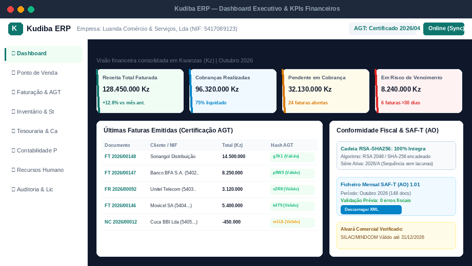
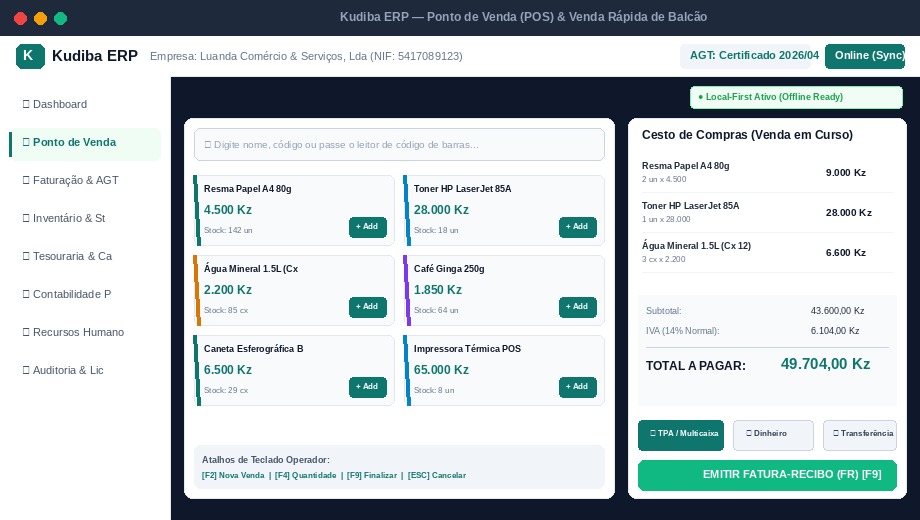
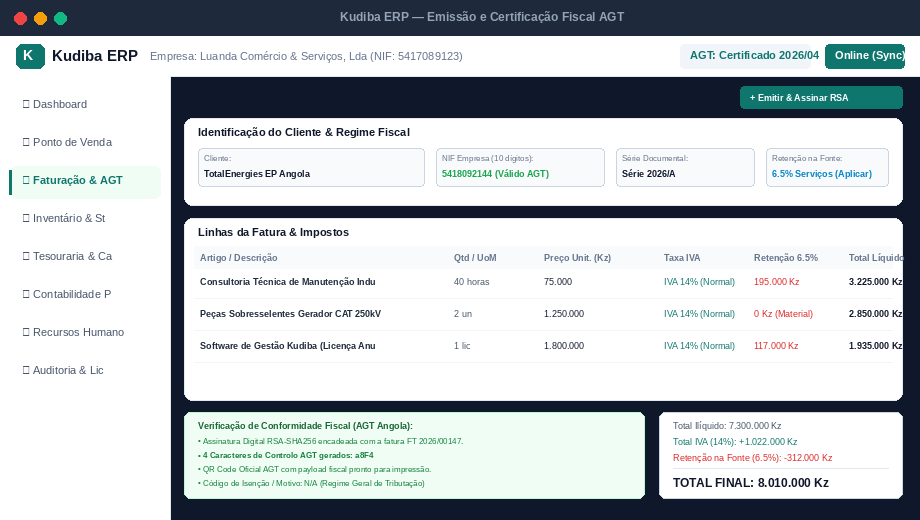
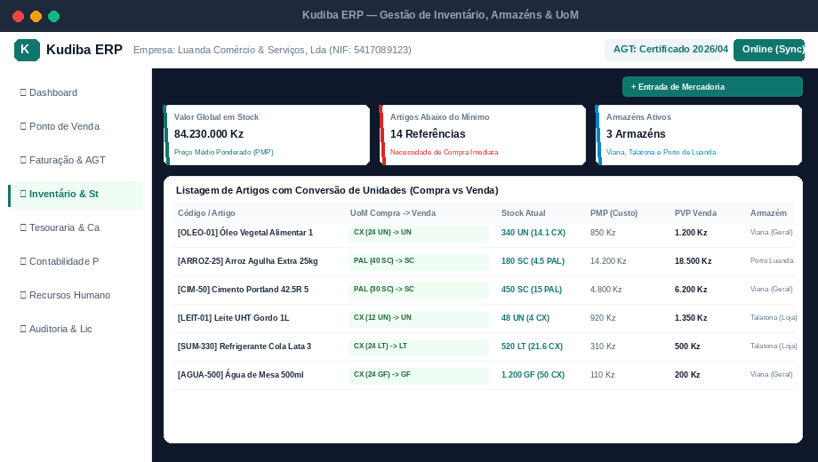
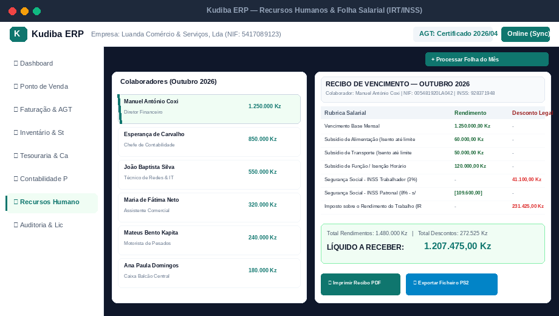
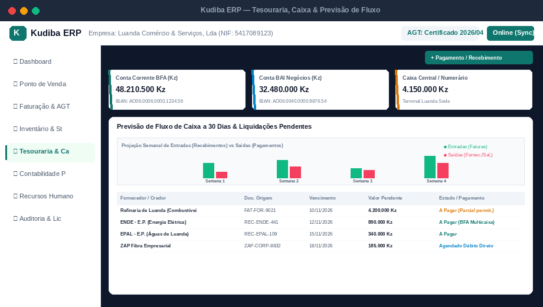

# KUDIBA ERP — Apresentação Comercial, Funcional e Guia do Utilizador

> **Edição Comercial:** 2026 / 2027  
> **Conformidade Legal:** Decreto Presidencial n.º 71/25 e Decreto Executivo n.º 385/20 da AGT (República de Angola)  
> **Público-Alvo:** Clientes B2B, Administradores, Diretores Gerais, Financeiros e de TI  
> **Ficheiro PDF Oficial:** [`docs/Kudiba_ERP_Apresentacao_e_Guia_do_Utilizador.pdf`](file:///home/jaime.coxi@hssa.local/Documentos/DevelopmentEnv/kudiba/docs/Kudiba_ERP_Apresentacao_e_Guia_do_Utilizador.pdf)

---

## 1. Introdução ao Kudiba ERP

### 1.1 O que é o Kudiba ERP?
O **Kudiba ERP** é uma solução de gestão empresarial de 4.ª geração (*Cloud-Native* e *Edge-Ready*), projetada de raiz para atender às exigências fiscais, operacionais e de infraestrutura do mercado de **Angola e dos PALOP**.

A plataforma reúne de forma modular e integrada os seguintes pilares:
1. **Faturação Comercial & Retalho Certificada AGT**
2. **Ponto de Venda (POS) Balcão com Funcionamento Offline Resiliente**
3. **Gestão Avançada de Stocks, Armazéns e Conversão de Embalagens (UoM)**
4. **Tesouraria, Gestão de Caixas, Contas a Pagar/Receber e Previsão de Fluxo**
5. **Contabilidade Geral e Analítica (PGC Angolano)**
6. **Recursos Humanos, Folha Salarial com IRT 2026, INSS e Ficheiro Bancário PS2**
7. **Verificação Automatizada de Alvarás Comerciais em Tempo Real**

---

### 1.2 O Diagnóstico do Mercado: Por que os Softwares Tradicionais Falham em Angola?
Durante décadas, as empresas angolanas dependeram de plataformas concebidas nos anos 90 (como Primavera/Cegid, PHC ou Sage), construídas sobre o modelo cliente-servidor para Windows. Esse ecossistema acarreta graves limitações:

* **Custos Elevados e Dependência Cambial:** Licenciamento cobrado por posto/módulo indexado ao Dólar ou Euro, que encarece brutalmente em períodos de desvalorização do Kwanza, acrescido de licenças Microsoft (Windows Server e MS SQL Server).
* **Paralisação das Vendas por Queda de Internet:** Os sistemas cloud convencionais bloqueiam o ponto de venda quando há oscilação de sinal ou falha do operador de telecomunicações.
* **Complexidade e Lentidão Operacional:** Telas densas, excesso de janelas modais sobrepostas e lentidão que elevam o tempo de atendimento e aumentam os erros operacionais.
* **Atualizações Regulatórias Onuosas:** Qualquer ajuste fiscal da AGT exige consultoria externa paga à hora e instalação morosa de *patches*.

---

### 1.3 O que o Kudiba Traz de Novo? (Diferenciais Inovadores)

1. **Arquitetura Híbrida Cloud & Local-First (POS Offline):** O caixa vende e imprime faturas sem internet. Assim que a rede estabiliza, os dados sincronizam automaticamente sem intervenção humana.
2. **Motor Fiscal e Criptográfico AGT Isolado:** Assinatura em cadeia RSA-2048 com algoritmo SHA-256 estrito, QR Code fiscal oficial e exportação nativa de SAF-T (AO) 1.01 sem inconsistências.
3. **Validador Oficial de Alvarás Comerciais:** Consulta em tempo real aos portais SILAC/MINDCOM, GUE, SEPE e AGT para verificar a regularidade do alvará e prevenir coimas tributárias.
4. **Desempenho Extremo em Rust:** O núcleo de faturação, inventário e tesouraria é compilado em Rust nativo, com tempo de resposta sub-10ms e consumo mínimo de hardware.
5. **Trilha de Auditoria Universal Imutável:** Registo completo de utilizador, IP, hora e ação para cada documento emitido ou retificado.

---

### 1.4 Matriz Comparativa: Kudiba vs Sistemas Tradicionais

| Vetor de Análise | ERPs Legados (Primavera, PHC, Sage) | Kudiba ERP (Nova Geração) |
| :--- | :--- | :--- |
| **Arquitetura Base** | Monólito anos 90 adaptado para web | Microsserviços modernos em Rust + Python, Cloud & Edge |
| **Operação Offline no Balcão** | Inexistente ou instável; queda de rede trava o POS | **Local-First nativo: vende offline e sincroniza em lote** |
| **Infraestrutura de Servidor** | Windows Server + Microsoft SQL Server pagos | **Linux + PostgreSQL open-source (0 Kz em licenças de BD)** |
| **Moeda e Preço** | Indexado a USD/EUR com risco cambial | **Preço fixo em Kwanzas (Kz), 100% previsível** |
| **Validação de Alvarás** | Processo manual externo | **Verificação automática via SILAC/MINDCOM e AGT** |
| **Curva de Aprendizagem** | 3 a 6 meses de treino | **Produtividade imediata em 48 horas** |
| **Integração Externa** | Módulos pagos, APIs SOAP lentas | **API REST aberta, Webhooks e OpenAPI integrados** |

---

## 2. Módulos e Funcionalidades Detalhadas

### 2.1 KudibaInvoicing (Faturação Comercial & Certificada AGT)
- Tipos de Documentos: Faturas (FT), Faturas-Recibo (FR), Notas de Crédito (NC), Notas de Débito (ND), Faturas Pró-Forma (PP), Orçamentos (OR) e Guias de Remessa/Transporte (GR/GT).
- Cadeia criptográfica com chave RSA-2048, SHA-256 encadeado e 4 caracteres de validação impressos.
- QR Code oficial em conformidade com as regras técnicas da AGT.
- Suporte a múltiplos regimes de IVA (14% Normal, Simplificado e Isenções com código de motivo legal M00-M99).
- Cálculo e desconto automático de Retenção na Fonte de 6.5% na prestação de serviços.
- Exportação e validação sintática do ficheiro XML SAF-T (AO) 1.01.

### 2.2 KudibaInventory (Gestão de Stocks, Armazéns e Logística)
- Conversão automática de unidades de medida (UoM): compra por palete ou caixa e venda à unidade/peso com histórico de equivalências.
- Controlo de Custo Médio Ponderado (PMP) em tempo real, integrando fretes e despesas aduaneiras.
- Multi-armazém: transferências entre armazém central, lojas e viaturas de distribuição com guias internas.
- Rastreio de lotes e prazos de validade com alertas para regras FIFO/FEFO.
- Inventários físicos periódicos (cegos ou guiados) com geração automática de autos de quebra ou sobras.

### 2.3 KudibaTreasury (Tesouraria, Caixa e Liquidações)
- Abertura, suprimentos, sangrias e fecho cego de caixas diários com conferência por operador.
- Reconciliação por meios de pagamento: Dinheiro, TPA Multicaixa, Transferência Bancária e Depósito.
- Liquidações parciais ou totais de faturas com emissão de Recibos (RC).
- Painel de Aging de dívidas de clientes e fornecedores por faixas de vencimento.
- Projeção dinâmica de fluxo de caixa (Cash Flow) a 30, 60 e 90 dias cruzando compromissos reais.

### 2.4 KudibaAccounting (Contabilidade PGC Angolano)
- Estrutura completa do Plano Geral de Contabilidade (Classes 1 a 8) pré-parametrizada.
- Lançamentos automáticos gerados pela faturação, compras e tesouraria em partidas dobradas.
- Contabilidade analítica por Centros de Custos (projetos, obras, lojas ou departamentos).
- Balancetes de verificação a 2, 4 e 6 colunas emitidos em segundos.
- Balanços e Demonstrações de Resultados em conformidade para o Modelo 1 do Imposto Industrial.

### 2.5 KudibaPayroll (Recursos Humanos, Salários e IRT/INSS)
- Cálculo oficial do IRT de acordo com a tabela progressiva em vigor em Angola.
- Apuramento da Segurança Social: 3% (desconto do trabalhador) e 8% (encargo patronal).
- Subsídios parametrizáveis: alimentação e transporte (com limite de isenção fiscal), férias e 13.º mês.
- Gestão de assiduidade, presenças, faltas justificadas/injustificadas e marcação de férias.
- Emissão de recibos de vencimento em PDF confidencial e exportação do ficheiro bancário PS2 (Multicaixa).

### 2.6 KudibaBackoffice & Governança
- Verificador oficial de Alvarás Comerciais conectado aos registos públicos de Angola.
- Controlo granular de acessos por função (RBAC) e separação de lojas por séries independentes.
- Trilha de auditoria universal de segurança imutável.

---

## 3. Custos e Curva de Aprendizagem

### 3.1 Modelos de Planos Comerciais

| Plano | Indicado Para | Módulos | Utilizadores / Postos | Suporte |
| :--- | :--- | :--- | :--- | :--- |
| **Kudiba Comercial** | Retalho, comércio a grosso e oficinas | Faturação AGT + POS Offline + Stocks + Caixa | Até 3 postos | Suporte remoto dias úteis |
| **Kudiba PME Integrado** | Pequenas e Médias Empresas em crescimento | Faturação + POS + Stocks + Tesouraria + Payroll | Até 8 utilizadores | Suporte prioritário + formação |
| **Kudiba Corporate** | Grupos empresariais e indústrias multi-loja | Todos os módulos + Contabilidade PGC + API | Escalável / Ilimitado | Gestor dedicado + SLA 2h |

### 3.2 Poupança Comprovada no TCO a 3 Anos
- **Licenciamento do Software:** Poupança de até 60% por ser em Kwanzas sem taxa de conversão cambial.
- **Licenciamento de Banco de Dados:** Poupança de 100% ao eliminar Microsoft SQL Server através de PostgreSQL Linux.
- **Hardware & Servidores:** Redução de até 76% no custo de servidores físicos devido à leveza dos containers.
- **Total de Poupança Acumulada:** Estimada em mais de **65% a 78%** face ao modelo de ERP legado tradicional.

### 3.3 Curva de Aprendizagem e Onboarding
- **Operadores de Caixa:** Produtivos em menos de 2 horas graças ao fluxo ergonómico do POS e atalhos rápidos (`F2`, `F4`, `F9`).
- **Equipa Financeira / Administrativa:** Formação concluída em 48 horas com simulação em base de dados de testes.
- **Migração de Dados:** Ferramentas automáticas para carregar artigos, preços e clientes a partir de ficheiros Excel ou SAF-T.

---

## 4. Screenshots e Guia Prático do Utilizador

### 4.1 Painel Executivo & Dashboard Financeiro

1. **Filtro de Período:** Selecione o horizonte temporal (Hoje, Mês Atual, Trimestre ou Ano) no canto superior.
2. **Acompanhamento de KPIs:** Verifique receita total faturada, valores já cobrados e pendentes em risco.
3. **Validação Criptográfica AGT:** No painel lateral, confirme que a cadeia RSA-SHA256 apresenta estado íntegro.
4. **SAF-T (AO):** Exporte com um clique o ficheiro mensal validado para entrega fiscal.

---

### 4.2 Ponto de Venda (POS) & Vendas Rápidas Offline

1. **Adicionar Artigos:** Passe o leitor ótico no código de barras ou pesquise por nome (`⌘K`).
2. **Alterar Quantidades:** Utilize a tecla `[F4]` para ajustar quantidades instantaneamente.
3. **Forma de Pagamento:** Selecione entre TPA Multicaixa, Dinheiro ou Transferência.
4. **Finalizar Venda:** Pressione `[F9]` para assinar e emitir a Fatura-Recibo térmica em menos de 1 segundo.
5. **Modo Offline:** Na ausência de internet, o indicador superior confirma que a operação continua ativa localmente.

---

### 4.3 Emissão de Faturas Certificadas AGT

1. **Dados do Cliente:** Introduza o NIF (10 dígitos). O sistema valida a conformidade e carrega os dados oficiais.
2. **Linhas de Artigos e Serviços:** Adicione produtos ou serviços; o IVA e a retenção de 6.5% são calculados de imediato.
3. **Pré-visualização da Assinatura:** O sistema exibe o hash encadeado e os 4 caracteres fiscais de controlo.
4. **Conclusão:** Clique em `[+ Emitir & Assinar RSA]` para gerar o documento oficial com QR Code AGT.

---

### 4.4 Gestão de Inventário e Conversão de Embalagens (UoM)

1. **Entrada de Mercadoria:** Registe a compra na unidade do fornecedor (ex: Paletes ou Caixas de 24 un).
2. **Conversão Automática:** O stock é alimentado na unidade base de venda ao público.
3. **Monitorização de PMP:** O Preço Médio Ponderado é recalculado a cada nova fatura de compra.
4. **Transferências:** Mova artigos entre o Armazém Central e as Lojas com guias de remessa eletrónicas.

---

### 4.5 Processamento Salarial e Recibos de Vencimento

1. **Seleção do Mês:** Escolha o período de processamento da folha salarial.
2. **Lançamento de Incidências:** Insira horas extras, faltas ou prémios de produtividade.
3. **Cálculo Oficial:** O sistema processa os escalões do IRT e os 3% de INSS do colaborador.
4. **Emissão de Ficheiros:** Exporte o ficheiro bancário `PS2` para pagamento em lote e gere os recibos em PDF.

---

### 4.6 Tesouraria, Contas a Pagar e Previsão de Fluxo de Caixa

1. **Controlo de Bancos e Caixas:** Visualize em tempo real os saldos no BFA, BAI e Caixa Sede.
2. **Projeção de Fluxo:** Acompanhe o gráfico semanal comparativo entre recebimentos previstos e compromissos.
3. **Liquidação a Fornecedores:** Proceda a pagamentos totais ou parciais de faturas pendentes.
4. **Reconciliação:** Movimentos conciliados automaticamente com os diários da contabilidade analítica.

---

## 5. Contactos Comerciais & Demonstração Gratuita

Para agendar uma sessão de demonstração presencial ou remota para a sua administração:

* **Email:** comercial@kudiba.ao
* **Telefones / WhatsApp:** (+244) 929 774 155 / 954 803 229 / 925 171 233
* **Sede:** Edifício Kudiba Tech, Luanda — República de Angola
* **Ficheiro PDF para Envio:** [`docs/Kudiba_ERP_Apresentacao_e_Guia_do_Utilizador.pdf`](file:///home/jaime.coxi@hssa.local/Documentos/DevelopmentEnv/kudiba/docs/Kudiba_ERP_Apresentacao_e_Guia_do_Utilizador.pdf)
