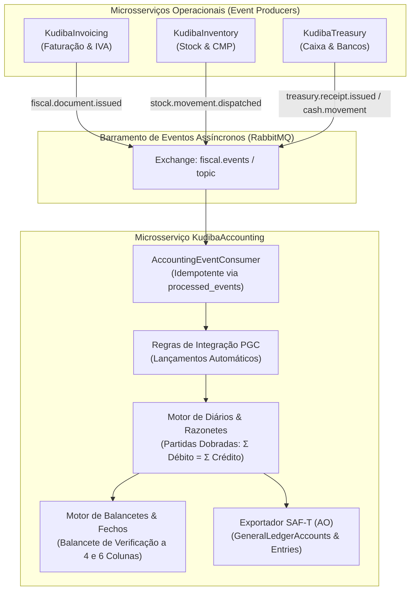
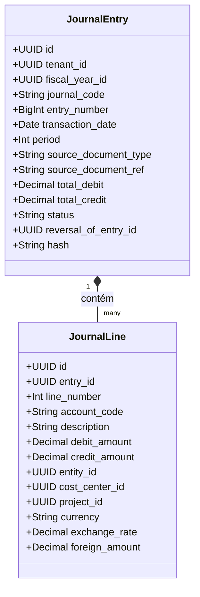
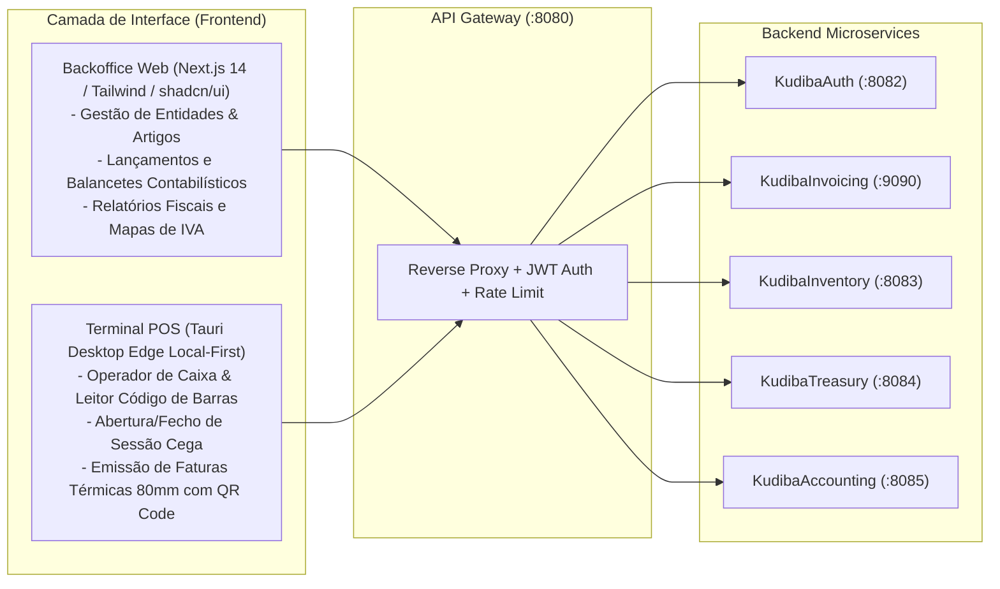

# Plano Arquitetural e de Implementação: Contabilidade Geral & PGC Angolano (`KudibaAccounting`)

**Projeto:** Kudiba ERP — Núcleo Financeiro e Fiscal  
**Módulo:** `KudibaAccounting` (Contabilidade Geral e Analítica)  
**Data:** Outubro de 2026  
**Enquadramento Legal:**  
- **Decreto n.º 82/01 de 16 de Novembro**: Plano Geral de Contabilidade de Angola (PGC).  
- **Decreto Executivo n.º 385/20**: Estrutura e Validação do SAF-T (AO) v1.01_01 (Ficheiro de Contabilidade `C` e `I`).  
- **Decreto Presidencial n.º 71/25**: Regime Jurídico das Facturas e Documentos Equivalentes (RJFDE).  
- **Código Geral Tributário (Lei n.º 21/14)** e **Código do IVA (Lei n.º 42/20)**.

---

## 1. Visão Executiva e Motivação Arquitetural

Com a conclusão e validação em produção dos três primeiros blocos operacionais:
1. [**`KudibaAuth`**](file:///mnt/c/Users/Jaime/Documents/Repos/Kudiba/Backend/services/KudibaAuth): Identidade, RBAC granular e multi-tenancy corporativo;
2. [**`KudibaInvoicing`**](file:///mnt/c/Users/Jaime/Documents/Repos/Kudiba/Backend/services/KudibaInvoicing): Motor fiscal imutável certificado pela AGT (FT, FR, NC, ND, GT, GR, QR Code, X/Z);
3. [**`KudibaInventory`**](file:///mnt/c/Users/Jaime/Documents/Repos/Kudiba/Backend/services/KudibaInventory): Gestão multi-armazém, lotes FIFO/FEFO e recálculo de CMP;
4. [**`KudibaTreasury`**](file:///mnt/c/Users/Jaime/Documents/Repos/Kudiba/Backend/services/KudibaTreasury): Caixas de balcão, fecho cego com auditoria de quebra/sobra, contas bancárias e recibos (RC);

O ERP Kudiba atinge o momento em que todos os factos patrimoniais e comerciais convergem para a **Contabilidade Geral**. Sem este módulo, o sistema limita-se a gestão comercial; com o **`KudibaAccounting`**, transforma-se num verdadeiro ERP de padrão bancário e auditoria fiduciária, automatizando a escrita de **Partidas Dobradas** a partir de eventos assíncronos do barramento **RabbitMQ**.



---

## 2. Enquadramento Legal do PGC de Angola (Decreto n.º 82/01)

O **Plano Geral de Contabilidade (PGC)** angolano organiza as contas em 8 classes fundamentais. O `KudibaAccounting` implementará a árvore do PGC nativamente:

### 2.1 Estrutura das Classes do PGC
- **Classe 1: Meios Fixos e Investimentos**
  - `11`: Imobilizações Corpóreas (Terrenos, Edifícios, Equipamento de Transporte, Equipamento Administrativo/Informático).
  - `12`: Imobilizações Incorpóreas (Software, Marcas, Licenças, Trespasses).
  - `18`: Amortizações Acumuladas.
- **Classe 2: Existências**
  - `21`: Compras de Mercadorias e Matérias.
  - `22`: Matérias-Primas, Subsidiárias e de Consumo.
  - `24`: Produtos Acabados e Intermédios.
  - `26`: Mercadorias em Armazém.
  - `28`: Regularização de Existências (Inventários físicos / Quebras e Sobras).
- **Classe 3: Terceiros**
  - `31`: Clientes (`31.1` Clientes Nacionais - Conta Corrente, `31.2` Clientes Títulos a Receber).
  - `32`: Fornecedores (`32.1` Fornecedores Nacionais - Conta Corrente).
  - `34`: Estado e Outros Entes Públicos:
    - `34.1`: Imposto sobre os Lucros / Imposto Industrial (Estimativa de Imposto do Exercício / Pagamento Provisório).
    - `34.2`: Imposto de Produção e Consumo.
    - `34.3`: Imposto sobre o Rendimento do Trabalho (IRT).
    - `34.5`: IVA (Lei n.º 42/20 e Diretrizes OCPCA):
      - `34.5.1`: IVA Suportado (`34.5.1.1` Operações Correntes, `34.5.1.2` Ativos Fixos).
      - `34.5.2`: IVA Dedutível (com apuramento de afetação real ou pro-rata).
      - `34.5.3`: IVA Liquidado (`34.5.3.1` Taxa Geral 14%, `34.5.3.2` Taxa Reduzida 5%, `34.5.3.3` Regime Simplificado 7%).
      - `34.5.4`: IVA Retido na Fonte / Catividade (50% ou 100% praticado por Grandes Contribuintes/Bancos).
      - `34.5.5`: IVA a Regularizar (Notas de crédito e créditos de cobrança duvidosa).
      - `34.5.6`: IVA — Apuramento (Fecho mensal de IVA).
      - `34.5.7`: IVA a Pagar.
      - `34.5.8`: IVA a Recuperar / Compensar.
    - `34.8`: Subsídios / Retenções na Fonte de Imposto Industrial (6,5% s/ Serviços):
      - `34.8.1`: Retenção de Imposto Industrial Suportada (Ativo — retida pelos clientes sobre as nossas vendas).
      - `34.8.2`: Retenção de Imposto Industrial Efetuada a Terceiros (Passivo — retida aos fornecedores a entregar ao Estado).
    - `34.9`: Outros Impostos e Segurança Social:
      - `34.9.1`: Segurança Social / INSS (`34.9.1.1` INSS Retido ao Pessoal 3%, `34.9.1.2` INSS Encargo Patronal 8%).
      - `34.9.2`: Imposto de Selo (0,7% Operações Financeiras / 1% Recibo de Quitação).
  - `36`: Pessoal (Remunerações a Pagar, Adiantamentos).
  - `37`: Outros Valores a Receber e a Pagar.
- **Classe 4: Meios Monetários**
  - `41`: Títulos Negociáveis.
  - `42`: Depósitos a Prazo.
  - `43`: Depósitos à Ordem (`43.1` Moeda Nacional AOA, `43.2` Moeda Estrangeira USD/EUR).
  - `45`: Caixa (`45.1` Caixa Geral / Fundo Fixo, `45.2` Caixas de Balcão / Valores para Depositar).
- **Classe 5: Capital e Reservas**
  - `51`: Capital (`51.1` Capital Social Subscrito e Realizado).
  - `55`: Reservas Legais.
  - `58`: Reservas Livres.
  - `59`: Resultados Transitados.
- **Classe 6: Proveitos e Ganhos por Natureza**
  - `61`: Vendas (`61.1` Vendas de Produtos Acabados e Intermédios, `61.3` Vendas de Mercadorias).
  - `62`: Prestações de Serviço (`62.1` Serviços Prestados no Mercado Nacional, `62.2` Mercado Estrangeiro).
  - `63`: Outros Proveitos Operacionais.
  - `66`: Proveitos e Ganhos Financeiros Gerais:
    - `66.1`: Juros Obtidos.
    - `66.2`: Diferenças de Câmbio Favoráveis (Ganhos Cambiais Realizados e Não Realizados).
    - `66.3`: Descontos de Pronto Pagamento Obtidos.
- **Classe 7: Custos e Perdas por Natureza**
  - `71`: Custo das Mercadorias Vendidas e Matérias Consumidas (**CMVMC**).
  - `72`: Custos com o Pessoal (`72.2` Remunerações do Pessoal, `72.5` Encargos sobre Remunerações - INSS Patronal 8%).
  - `73`: Amortizações do Exercício.
  - `75`: Outros Custos e Perdas Operacionais:
    - `75.2`: Fornecimentos e Serviços de Terceiros (**FSE**: Água, Eletricidade, Comunicações, Rendas, Conservação).
    - `75.3`: Impostos e Tributos (`75.3.1.1` Imposto de Selo Suportado).
  - `76`: Custos e Perdas Financeiros Gerais:
    - `76.1`: Juros Suportados.
    - `76.2`: Diferenças de Câmbio Desfavoráveis (Perdas Cambiais Realizadas e Não Realizadas).
    - `76.3`: Descontos de Pronto Pagamento Concedidos.
    - `76.4`: Comissões e Despesas Bancárias.
- **Classe 8: Resultados**
  - `82`: Resultados Operacionais.
  - `83`: Resultados Financeiros.
  - `84`: Resultados em Filiais e Associadas.
  - `85`: Resultados Não Operacionais.
  - `86`: Resultados Extraordinários.
  - `87`: Imposto sobre os Lucros (Imposto Industrial do Exercício).
  - `88`: Resultado Líquido do Exercício.

---

## 3. Matriz de Lançamentos Automáticos (Partidas Dobradas)

A cada evento recebido via RabbitMQ, o motor contabilístico gera um **Lançamento (Journal Entry)** que obedece rigorosamente ao princípio de equilíbrio patrimonial:

$$\sum \text{Débitos} = \sum \text{Créditos}$$



### 3.1 Venda a Prazo (Fatura FT de Mercadorias com IVA 14%)
* **Evento:** `fiscal.document.issued` (`doc_type = 'FT'`)
* **Lançamento:**
  - **DÉBITO:** `31.1.2.1` Clientes Correntes — Nacionais (Valor Bruto Total da Fatura)
  - **CRÉDITO:** `61.3.1` Vendas de Mercadorias — Mercado Nacional (Valor Líquido sem Imposto)
  - **CRÉDITO:** `34.5.3.1` Estado — IVA Liquidado Geral 14% (Valor do IVA a 14%)

### 3.2 Venda de Serviços com Retenção na Fonte de 6,5% (Art. 12.º Decreto 71/25)
* **Evento:** `fiscal.document.issued` (`doc_type = 'FT'`, serviços com retenção)
* **Lançamento:**
  - **DÉBITO:** `31.1.2.1` Clientes Correntes — Nacionais (Valor a Receber Líquido da Retenção)
  - **DÉBITO:** `34.8.1` Estado — Retenção de Imposto Industrial Suportada (6,5% Ativo)
  - **CRÉDITO:** `62.1` Serviços Prestados no Mercado Nacional (Valor Bruto dos Honorários)
  - **CRÉDITO:** `34.5.3.1` Estado — IVA Liquidado Geral 14%

### 3.3 Venda a Pronto Pagamento no Balcão (Fatura-Recibo FR em Numerário)
* **Evento:** `fiscal.document.issued` (`doc_type = 'FR'`)
* **Lançamento:**
  - **DÉBITO:** `45.2` Caixas de Balcão / Valores para Depositar (Total recebido)
  - **CRÉDITO:** `61.3.1` Vendas de Mercadorias — Mercado Nacional (Valor Líquido)
  - **CRÉDITO:** `34.5.3.1` Estado — IVA Liquidado Geral 14%

### 3.4 Despacho de Stock / Custo da Mercadoria Vendida (CMVMC)
* **Evento:** `inventory.stock_movement.dispatched` (Calculado pelo CMP do KudibaInventory)
* **Lançamento:**
  - **DÉBITO:** `71.2` CMVMC — Mercadorias (Valor CMP $\times$ Qtd)
  - **CRÉDITO:** `26.1` Mercadorias em Armazém (Valor CMP $\times$ Qtd)

### 3.5 Liquidação / Recibo de Quitação de Fatura a Prazo (RC do KudibaTreasury)
* **Evento:** `treasury.receipt.issued`
  - Se liquidado por **Transferência Bancária**:
    - **DÉBITO:** `43.1` Bancos Depósitos à Ordem — Moeda Nacional (Valor creditado na conta bancária)
    - **CRÉDITO:** `31.1.2.1` Clientes Correntes — Nacionais (Quitação do saldo pendente)
  - Se liquidado em **Numerário**:
    - **DÉBITO:** `45.1` Caixa Geral / `45.2` Caixa de Balcão
    - **CRÉDITO:** `31.1.2.1` Clientes Correntes — Nacionais

### 3.6 Movimento de Sangria de Caixa para Cofre/Banco
* **Evento:** `treasury.cash_movement.bleed`
  - **DÉBITO:** `43.1` Bancos D.O. / `45.1` Caixa Geral
  - **CRÉDITO:** `45.2` Caixas de Balcão (Saída física de numerário)

### 3.7 Compra de Serviços Externos com Retenção na Fonte de 6,5% a Terceiros
* **Evento:** Registo de Fatura de Fornecedor de Serviços (`FSE`)
* **Lançamento:**
  - **DÉBITO:** `75.2` Fornecimentos e Serviços de Terceiros (Valor Bruto dos Serviços)
  - **DÉBITO:** `34.5.2` IVA Dedutível — Operações Correntes (IVA suportado dedutível)
  - **CRÉDITO:** `32.1.2.1` Fornecedores Correntes — Nacionais (Valor Líquido a Pagar ao Fornecedor)
  - **CRÉDITO:** `34.8.2` Estado — Retenção de Imposto Industrial Efetuada a Terceiros (6,5% Passivo a entregar à AGT)

### 3.8 Liquidação Multimoeda com Diferença de Câmbio (AOA vs USD/EUR)
* **Cenário:** Fatura emitida em USD (ex: \$1.000 ao câmbio de 900 AOA/USD = 900.000 AOA) liquidada posteriormente quando o câmbio oficial está a 920 AOA/USD (920.000 AOA).
* **Lançamento (Ganho Cambial na cobrança de Cliente):**
  - **DÉBITO:** `43.2` Bancos Depósitos à Ordem — Moeda Estrangeira (920.000 AOA equivalente a \$1.000)
  - **CRÉDITO:** `31.1.2.2` Clientes Correntes — Estrangeiros (900.000 AOA — baixa do título original)
  - **CRÉDITO:** `66.2` Diferenças de Câmbio Favoráveis (20.000 AOA)
* *Caso o câmbio descesse para 880 AOA/USD, debitar-se-ia `76.2` Diferenças de Câmbio Desfavoráveis (20.000 AOA).*

### 3.9 Imutabilidade e Lançamento de Estorno Contabilístico (Reversal)
* **Cenário:** Cancelamento ou anulação de uma Fatura/Recibo previamente integrada no razão (`POSTED`). Para cumprir o Decreto Executivo 385/20 e o RJFDE, **o registo original permanece intacto**; gera-se um lançamento espelho invertido:
* **Lançamento de Estorno:**
  - **Status:** `POSTED`
  - **`reversal_of_entry_id`:** UUID do lançamento original.
  - **Linhas:** Débitos do original convertem-se em Créditos, e Créditos em Débitos pelos montantes exatos.
  - **Status do lançamento original:** Atualizado atomicamente para `REVERSED`.

---

## 4. Desenho da Base de Dados Relacional (`kudiba_accounting`)

Seguindo rigorosamente o princípio arquitetural **Database-per-Service**:

```sql
-- Schema kudiba_accounting
CREATE SCHEMA IF NOT EXISTS kudiba_accounting;

-- 1. EXERCÍCIOS FISCAIS / ANOS ECONÓMICOS
CREATE TYPE fiscal_year_status AS ENUM ('OPEN', 'CLOSING_IN_PROGRESS', 'CLOSED');

CREATE TABLE kudiba_accounting.fiscal_years (
    id UUID PRIMARY KEY DEFAULT gen_random_uuid(),
    tenant_id UUID NOT NULL,
    year_code INT NOT NULL, -- Ex: 2026
    start_date DATE NOT NULL,
    end_date DATE NOT NULL,
    status fiscal_year_status NOT NULL DEFAULT 'OPEN',
    is_active BOOLEAN NOT NULL DEFAULT TRUE,
    created_at TIMESTAMPTZ NOT NULL DEFAULT NOW(),
    CONSTRAINT uq_tenant_fiscal_year UNIQUE (tenant_id, year_code)
);

-- 2. PLANO GERAL DE CONTAS (PGC ANGOLA)
CREATE TYPE account_class AS ENUM (
    'CLASS_1_MEIOS_FINANCEIROS',
    'CLASS_2_EXISTENCIAS',
    'CLASS_3_TERCEIROS',
    'CLASS_4_IMOBILIZACOES',
    'CLASS_5_CAPITAL_PROPRIO',
    'CLASS_6_CUSTOS',
    'CLASS_7_PROVEITOS',
    'CLASS_8_RESULTADOS'
);

CREATE TYPE account_nature AS ENUM ('DEBIT', 'CREDIT');

CREATE TABLE kudiba_accounting.chart_of_accounts (
    id UUID PRIMARY KEY DEFAULT gen_random_uuid(),
    tenant_id UUID NOT NULL,
    account_code VARCHAR(30) NOT NULL, -- Ex: "11.1", "31.1.1.0001", "71.1"
    parent_account_code VARCHAR(30),   -- Ex: "11" para "11.1"
    account_name VARCHAR(255) NOT NULL,
    account_class account_class NOT NULL,
    account_nature account_nature NOT NULL, -- Natureza normal do saldo
    is_analytical BOOLEAN NOT NULL DEFAULT TRUE, -- TRUE = permite lançamentos; FALSE = conta agregadora/sintética
    is_system_reserved BOOLEAN NOT NULL DEFAULT FALSE,
    saft_grouping_code VARCHAR(30), -- Mapeamento para GroupingCode do SAF-T AO
    is_active BOOLEAN NOT NULL DEFAULT TRUE,
    created_at TIMESTAMPTZ NOT NULL DEFAULT NOW(),
    CONSTRAINT uq_tenant_account_code UNIQUE (tenant_id, account_code)
);

-- 3. DIÁRIOS CONTABILÍSTICOS
CREATE TYPE journal_type AS ENUM (
    'SALES',       -- Diário de Vendas
    'PURCHASES',   -- Diário de Compras
    'CASH',        -- Diário de Caixa
    'BANK',        -- Diário de Bancos
    'OPERATIONS',  -- Diário de Operações Diversas
    'CLOSING'      -- Diário de Apuramento e Fecho de Resultados
);

CREATE TABLE kudiba_accounting.journals (
    id UUID PRIMARY KEY DEFAULT gen_random_uuid(),
    tenant_id UUID NOT NULL,
    code VARCHAR(10) NOT NULL, -- Ex: "VEND", "COMP", "CX", "BC", "OD"
    name VARCHAR(100) NOT NULL,
    journal_type journal_type NOT NULL,
    current_sequence BIGINT NOT NULL DEFAULT 0,
    is_active BOOLEAN NOT NULL DEFAULT TRUE,
    created_at TIMESTAMPTZ NOT NULL DEFAULT NOW(),
    CONSTRAINT uq_tenant_journal_code UNIQUE (tenant_id, code)
);

-- 4. LANÇAMENTOS CONTABILÍSTICOS (CABEÇALHO)
CREATE TYPE entry_status AS ENUM ('DRAFT', 'POSTED', 'REVERSED');

CREATE TABLE kudiba_accounting.journal_entries (
    id UUID PRIMARY KEY DEFAULT gen_random_uuid(),
    tenant_id UUID NOT NULL,
    fiscal_year_id UUID NOT NULL REFERENCES kudiba_accounting.fiscal_years(id),
    journal_id UUID NOT NULL REFERENCES kudiba_accounting.journals(id),
    entry_number BIGINT NOT NULL, -- Sequencial contínuo por diário/ano
    transaction_date DATE NOT NULL,
    system_entry_date TIMESTAMPTZ NOT NULL DEFAULT NOW(),
    period INT NOT NULL CHECK (period BETWEEN 1 AND 14), -- 1..12: Meses civis; 13: Ajustes/Inventários de Auditoria; 14: Fecho da Classe 8
    description TEXT NOT NULL,
    source_service VARCHAR(50), -- "invoicing", "inventory", "treasury", "manual"
    source_document_type VARCHAR(20), -- "FT", "FR", "NC", "RC", "STOCK_CMP"
    source_document_id UUID,
    source_document_ref VARCHAR(100), -- Ex: "FT 2026A/000123"
    total_debit NUMERIC(18, 4) NOT NULL DEFAULT 0,
    total_credit NUMERIC(18, 4) NOT NULL DEFAULT 0,
    status entry_status NOT NULL DEFAULT 'POSTED',
    reversal_of_entry_id UUID REFERENCES kudiba_accounting.journal_entries(id), -- Aponta para o lançamento anulado por estorno
    hash VARCHAR(64), -- Hash SHA-256 encadeado fiduciário (conforme Decreto Presidencial 71/25)
    created_by UUID,
    created_at TIMESTAMPTZ NOT NULL DEFAULT NOW(),
    CONSTRAINT uq_tenant_journal_entry UNIQUE (tenant_id, journal_id, fiscal_year_id, entry_number),
    CONSTRAINT chk_balanced_entry CHECK (total_debit = total_credit)
);

-- 5. LINHAS DO LANÇAMENTO CONTABILÍSTICO (PARTIDAS DOBRADAS)
CREATE TABLE kudiba_accounting.journal_lines (
    id UUID PRIMARY KEY DEFAULT gen_random_uuid(),
    tenant_id UUID NOT NULL,
    entry_id UUID NOT NULL REFERENCES kudiba_accounting.journal_entries(id) ON DELETE RESTRICT,
    line_number INT NOT NULL,
    account_code VARCHAR(30) NOT NULL,
    description TEXT,
    debit_amount NUMERIC(18, 4) NOT NULL DEFAULT 0,
    credit_amount NUMERIC(18, 4) NOT NULL DEFAULT 0,
    entity_id UUID, -- Vinculação opcional a cliente/fornecedor (Sub-razão)
    cost_center_id UUID, -- Dimensão Analítica: Centro de Custo / Loja / Departamento
    project_id UUID, -- Dimensão Analítica: Projeto / Obra / Contrato
    currency VARCHAR(3) NOT NULL DEFAULT 'AOA',
    exchange_rate NUMERIC(15, 6) NOT NULL DEFAULT 1.000000,
    foreign_amount NUMERIC(18, 4), -- Montante na moeda estrangeira (ex: USD/EUR)
    created_at TIMESTAMPTZ NOT NULL DEFAULT NOW(),
    CONSTRAINT uq_entry_line UNIQUE (entry_id, line_number),
    CONSTRAINT chk_positive_line CHECK (debit_amount >= 0 AND credit_amount >= 0),
    CONSTRAINT chk_single_sided CHECK ((debit_amount > 0 AND credit_amount = 0) OR (credit_amount > 0 AND debit_amount = 0))
);

-- 6. AUDITORIA E DEDUP DE EVENTOS CONSUMIDOS (IDEMPOTÊNCIA ACID)
CREATE TABLE kudiba_accounting.processed_events (
    event_id UUID PRIMARY KEY,
    tenant_id UUID NOT NULL,
    event_type VARCHAR(100) NOT NULL,
    source_ref VARCHAR(100) NOT NULL,
    processed_at TIMESTAMPTZ NOT NULL DEFAULT NOW()
);
```

---

## 5. Arquitetura de Software do Microsserviço (`KudibaAccounting`)

O serviço será implementado em **Rust** utilizando o ecossistema comprovado nos outros módulos: **Axum 0.8**, **SQLx 0.9 (PostgreSQL)**, **Tokio** e **Lapin (RabbitMQ)**, com estrutura estrita de **Clean Architecture / Ports & Adapters**:

```
Backend/services/KudibaAccounting/
├── Cargo.toml
├── Dockerfile
├── src/
│   ├── application/
│   │   ├── commands/
│   │   │   ├── create_account_cmd.rs
│   │   │   ├── post_manual_entry_cmd.rs
│   │   │   ├── process_invoice_event_cmd.rs
│   │   │   ├── process_stock_event_cmd.rs
│   │   │   └── process_treasury_event_cmd.rs
│   │   ├── queries/
│   │   │   ├── get_chart_of_accounts.rs
│   │   │   ├── get_journal_entries.rs
│   │   │   ├── get_trial_balance.rs           # Balancete de Verificação (4 e 6 colunas)
│   │   │   ├── get_general_ledger_view.rs     # Razonetes
│   │   │   └── export_accounting_saft.rs      # SAF-T AO Contabilidade (XML Stream)
│   │   └── dto.rs
│   ├── domain/
│   │   ├── entities/
│   │   │   ├── account.rs
│   │   │   ├── fiscal_year.rs
│   │   │   ├── journal.rs
│   │   │   ├── journal_entry.rs
│   │   │   └── journal_line.rs
│   │   ├── services/
│   │   │   ├── accounting_engine.rs           # Validação estrita de partidas dobradas
│   │   │   └── pgc_rules_matcher.rs          # Regras fiscais e tributárias angolanas
│   │   ├── value_objects/
│   │   │   ├── account_class.rs
│   │   │   ├── entry_status.rs
│   │   │   └── money.rs
│   │   ├── ports/
│   │   │   ├── account_repo.rs
│   │   │   ├── journal_entry_repo.rs
│   │   │   └── fiscal_year_repo.rs
│   │   └── error.rs
│   ├── infrastructure/
│   │   ├── events/
│   │   │   ├── amqp_consumer.rs               # Consumidor RabbitMQ durável
│   │   │   └── event_handlers.rs
│   │   ├── persistence/
│   │   │   ├── postgres_account_repo.rs
│   │   │   ├── postgres_journal_entry_repo.rs
│   │   │   └── models.rs
│   │   └── saft/
│   │       └── accounting_saft_stream.rs      # Gerador XML SAF-T AO Tabela 3 e 4
│   ├── presentation/
│   │   └── http/
│   │       ├── routes.rs
│   │       └── handlers.rs
│   ├── config.rs
│   ├── state.rs
│   ├── lib.rs
│   └── main.rs
└── tests/
    └── test_accounting_engine_and_pgc.rs
```

---

## 6. Endpoints REST Expostos via API Gateway (`:8080`)

O API Gateway (`proxy.rs`) roteará as rotas `/api/v1/accounting/*` para o novo serviço (porta `:8085`):

| Método | Caminho | Descrição | Permissão RBAC |
| :--- | :--- | :--- | :--- |
| `GET` | `/api/v1/accounting/chart` | Listagem da árvore hierárquica do PGC Angolano | `accounting:view` |
| `POST` | `/api/v1/accounting/chart` | Criação de subconta analítica personalizada | `accounting:manage` |
| `GET` | `/api/v1/accounting/journals` | Listagem de diários ativos (Vendas, Caixa, Bancos) | `accounting:view` |
| `POST` | `/api/v1/accounting/entries` | Lançamento contabilístico manual por partidas dobradas | `accounting:post` |
| `GET` | `/api/v1/accounting/entries` | Consulta paginada e filtrada do Diário Geral | `accounting:view` |
| `GET` | `/api/v1/accounting/reports/trial-balance` | **Balancete de Verificação** (Saldos Iniciais, Movimentos a Débito/Crédito e Saldos Finais) | `accounting:reports` |
| `GET` | `/api/v1/accounting/reports/general-ledger` | **Extrato de Razonete** detalhado por conta do PGC | `accounting:reports` |
| `GET` | `/api/v1/accounting/saft` | Extração do ficheiro SAF-T (AO) Contabilidade (`C`) em XML | `fiscal:saft:export` |
| `POST` | `/api/v1/accounting/fiscal-years/close` | Procedimento de encerramento de exercício e apuramento da Classe 8 | `accounting:close_year` |

---

## 7. O Balancete de Verificação e o SAF-T (AO) de Contabilidade

### 7.1 Balancete de Verificação (Trial Balance)
O balancete gerado pelo `KudibaAccounting` apresentará a estrutura formal exigida pela auditoria angolana:
1. **Conta:** Código e Descrição PGC.
2. **Saldos Iniciais:** Débito / Crédito.
3. **Movimentos do Período:** Total Débito / Total Crédito.
4. **Saldos Acumulados:** Total Débito Acumulado / Total Crédito Acumulado.
5. **Saldos Finais:** Saldo Devedor / Saldo Credor.
6. **Verificação de Consistência:** Regra fiduciária $\sum \text{Débitos} = \sum \text{Créditos}$ e $\sum \text{Saldos Devedores} = \sum \text{Saldos Credores}$.

### 7.2 SAF-T (AO) Estrutura de Contabilidade (`C`)
O Decreto Executivo 385/20 exige no ficheiro de Contabilidade:
* **Tabela 3 (`GeneralLedgerAccounts`)**:
  - `AccountID`: Código PGC (ex.: `11.1.01`).
  - `AccountDescription`: Designação da conta.
  - `OpeningDebitBalance` / `OpeningCreditBalance`.
  - `ClosingDebitBalance` / `ClosingCreditBalance`.
  - `GroupingCategory` (`GR` - Grau, `AR` - Razão).
  - `GroupingCode`: Agrupamento PGC.
* **Tabela 4 (`GeneralLedgerEntries`)**:
  - `NumberOfEntries`, `TotalDebit`, `TotalCredit`.
  - `Journal`: Diário (`JournalID`, `Description`).
  - `Transaction`: Registo (`TransactionID`, `Period`, `TransactionDate`, `SourceID`, `Description`).
  - `Line`: Linhas de Débito/Crédito com `RecordID`, `AccountID`, `DebitAmount` ou `CreditAmount`.

### 7.3 Procedimento Automatizado de Fecho do Exercício e Apuramento da Classe 8

O fecho de contas no `KudibaAccounting` (acionado via `/api/v1/accounting/fiscal-years/close`) executa uma rotina transacional atómica no **Período 14 (Diário de Fecho `CLOSING`)** estruturada em 4 fases:

1. **Fase 1 — Transferência das Contas de Proveitos e Custos (Zerar Classes 6 e 7):**
   - **Resultados Operacionais (Conta `82`):**
     - Debita-se cada subconta de proveitos operacionais com saldo credor (`61` a `65`) e credita-se a conta `82`.
     - Credita-se cada subconta de custos operacionais com saldo devedor (`71` a `75`) e debita-se a conta `82`.
   - **Resultados Financeiros (Conta `83`):**
     - Debita-se proveitos financeiros (`66.1` a `66.3`) contra crédito na conta `83`.
     - Credita-se custos financeiros (`76.1` a `76.4`) contra débito na conta `83`.
   - As contas das Classes 6 e 7 ficam com saldo nulo ($0,00$).

2. **Fase 2 — Apuramento do Resultado Antes de Impostos (RAI):**
   - Transfere-se o saldo apurado em `82` (Resultados Operacionais), `83` (Resultados Financeiros), `85` (Resultados Não Operacionais) e `86` (Resultados Extraordinários) para a conta agregadora **`88` (Resultado Líquido do Exercício)**.

3. **Fase 3 — Estimativa de Imposto Industrial e Apuramento Líquido Final:**
   - Se o resultado antes de impostos for positivo (lucro tributável), calcula-se a provisão para Imposto Industrial (taxa nominal do regime geral de 25%):
     - **DÉBITO:** `87` (Imposto sobre os Rendimentos)
     - **CRÉDITO:** `34.1` (Estado — Imposto Industrial a Pagar / Provisão)
   - Transferência da conta `87` para a conta `88`:
     - **DÉBITO:** `88` (Resultado Líquido do Exercício)
     - **CRÉDITO:** `87` (Imposto sobre os Rendimentos)
   - O saldo remanescente na conta `88` representa o **Resultado Líquido Final do Exercício** (lucro ou prejuízo líquido).

4. **Fase 4 — Bloqueio do Exercício N e Abertura Automática de N+1:**
   - O exercício fiscal N tem o status atualizado para `CLOSED` (bloqueio definitivo contra novos lançamentos).
   - No exercício N+1, gera-se o **Lançamento de Abertura (Período 1, Diário `OPERATIONS`)**:
     - Reabrem-se os saldos patrimoniais (Classes 1 a 5).
     - O saldo da conta `88` do exercício anterior transita obrigatoriamente para a conta **`56` (Resultados Transitados)**, aguardando deliberação de aplicação de resultados em assembleia geral (dividendos, reservas legais ou reinvestimento).

---

## 8. Alinhamento com a Opção de Frontend (Backoffice Web & POS)

Se o utilizador optar por alternar ou sequenciar com a camada de visualização, o Frontend conectará diretamente aos 4 módulos backend via Gateway `:8080`:



---

## 9. Plano de Execução em Fases

| Fase | Entregável | Critério de Aceitação |
| :--- | :--- | :--- |
| **Fase 1: Persistência & Seed PGC** | Criação de `06-accounting-schema.sql`, seed completo das contas padrão do PGC angolano (Classes 1 a 8) e registo no script `00-init-databases.sh`. | Base `kudiba_accounting` provisionada sem erros. |
| **Fase 2: Motor Contabilístico & Entidades** | Implementação de `KudibaAccounting` em Rust com validação estrita de equilíbrio $\sum D = \sum C$, criação de diários e lançamentos manuais. | Suíte de testes unitários aprovada com 100% de sucesso. |
| **Fase 3: Integração Assíncrona via RabbitMQ** | Consumidor AMQP subscrito à exchange `fiscal.events` que converte faturas, baixas de stock e recibos em lançamentos automáticos com dedup. | Testes de integração de eventos com idempotência. |
| **Fase 4: Balancetes & Relatórios Analíticos** | Endpoints de Balancete de Verificação (4 e 6 colunas) e Razonetes por conta. | Validação aritmética de saldos devedores e credores. |
| **Fase 5: Gateway, OpenAPI & CI/CD** | Mapeamento no API Gateway (`/api/v1/accounting/*`), enriquecimento do OpenAPI Swagger e pipeline do GitHub Actions em branches `accounting/test` e `accounting/main`. | CI/CD verde em todas as branches e merge limpo em `main`. |
