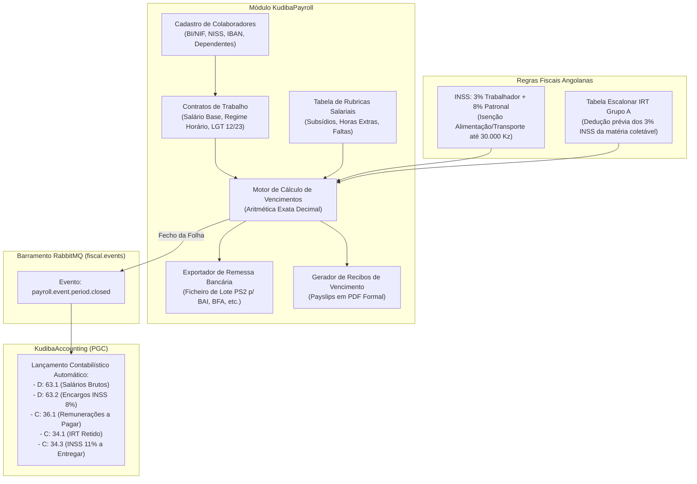

# Plano Arquitetural e de Implementação: Recursos Humanos & Processamento Salarial (`KudibaPayroll`)

**Projeto:** Kudiba ERP — Núcleo de Capital Humano & Processamento Salarial  
**Módulo:** `KudibaPayroll` (Recursos Humanos, Contratos, Folha de Salários e Obrigações Sociais)  
**Data:** Outubro de 2026  
**Enquadramento Legal e Regulatório (República de Angola):**  
- **Lei n.º 12/23 de 27 de Dezembro**: Lei Geral do Trabalho de Angola (**LGT** - revogou a Lei n.º 7/15).  
- **Lei n.º 18/14 de 22 de Outubro (com as alterações da Lei n.º 28/20 de 22 de Julho)**: Código do Imposto sobre o Rendimento do Trabalho (**IRT - Grupo A**).  
- **Decreto Presidencial n.º 227/18 de 27 de Setembro**: Regime Jurídico de Vinculação e Contribuição da Proteção Social Obrigatória (**INSS** - 3% trabalhador, 8% entidade empregadora).  
- **Decreto n.º 82/01 de 16 de Novembro**: Plano Geral de Contabilidade de Angola (**PGC** - Classe 6 Custos com o Pessoal e Classe 3 Estado/Terceiros).  
- **Normas Bancárias EMIS / BNA**: Formato de Ficheiro de Transferências Bancárias em Lote (**Formato PS2 / SEPA ASCII**).

---

## 1. Visão Executiva e Motivação Arquitetural

Com o núcleo operacional comercial, logístico e financeiro em pleno funcionamento:
1. `KudibaAuth`: Gestão de identidades, sessões, filiais e RBAC;
2. `KudibaInvoicing`: Motor fiscal imutável certificado pela AGT (FT, FR, NC, ND, GT, GR, QR Code, X/Z);
3. `KudibaInventory`: Gestão de armazéns, lotes FIFO/FEFO e recálculo de CMP;
4. `KudibaTreasury`: Caixas de balcão, fechos cegos, contas bancárias e recibos (RC);
5. `KudibaAccounting`: Contabilidade geral em partidas dobradas $\sum D = \sum C$, balancetes e SAF-T (AO);

O módulo **`KudibaPayroll`** completa a tríade corporativa essencial (**Comercial + Financeiro + Recursos Humanos**). Em qualquer empresa média ou grande em Angola, o processamento salarial representa o maior custo operacional individual e a fonte de maior risco trabalhista e fiscal se o cálculo do IRT e do INSS contiver desvios.



---

## 2. Enquadramento Legal e Regras Fiscais de Angola

### 2.1 Tabela Escalonar Progressiva do IRT (Grupo A - Lei n.º 28/20)
O cálculo do Imposto sobre o Rendimento do Trabalho (trabalhadores por conta de outrem) incide sobre a **Matéria Coletável ($MC$)**, apurada após deduções legais:

$$MC = \text{Rendimento Ilíquido Tributável} - \text{Dedução INSS (3\%)} - \text{Subsídios Isentos}$$

| Escalão de Matéria Coletável (Kz) | Parcela Fixa (Kz) | Taxa Marginal | Parcela a Abater no Excesso de |
| :--- | :--- | :--- | :--- |
| **Até 100.000,00** | 0,00 | **0% (Isento)** | — |
| **De 100.001,00 a 150.000,00** | 0,00 | **13%** | 100.000,00 |
| **De 150.001,00 a 200.000,00** | 6.500,00 | **16%** | 150.000,00 |
| **De 200.001,00 a 300.000,00** | 14.500,00 | **18%** | 200.000,00 |
| **De 300.001,00 a 500.000,00** | 32.500,00 | **19%** | 300.000,00 |
| **De 500.001,00 a 1.000.000,00** | 70.500,00 | **20%** | 500.000,00 |
| **De 1.000.001,00 a 1.500.000,00** | 170.500,00 | **21%** | 1.000.000,00 |
| **De 1.500.001,00 a 2.000.000,00** | 275.500,00 | **22%** | 1.500.000,00 |
| **De 2.000.001,00 a 2.500.000,00** | 385.500,00 | **23%** | 2.000.000,00 |
| **De 2.500.001,00 a 3.000.000,00** | 500.500,00 | **24%** | 2.500.000,00 |
| **Superior a 3.000.000,00** | 620.500,00 | **25%** | 3.000.000,00 |

### 2.2 Segurança Social Obrigatória (INSS - Decreto Presidencial n.º 227/18)
- **Contribuição do Trabalhador:** **3%** retidos na fonte sobre a remuneração de incidência.
- **Contribuição da Entidade Empregadora:** **8%** suportados integralmente pela empresa como encargo social.
- **Total a entregar aos cofres do INSS:** **11%** até ao dia 10 do mês seguinte àquele a que as remunerações dizem respeito.
- **Dedução de IRT:** O valor retido para o INSS (3%) é deduzido da matéria coletável antes da determinação da taxa de IRT.

### 2.3 Isenções Legais de Subsídios (Artigo 2.º do CIRT e LGT)
- **Subsídio de Alimentação:** Isento de IRT e de INSS até ao limite de **30.000,00 Kz / mês**. O excedente é tributado normalmente.
- **Subsídio de Transporte:** Isento de IRT e de INSS até ao limite de **30.000,00 Kz / mês**. O excedente é tributado normalmente.
- **Abono de Família:** Isento nos termos do regime de prestações sociais.

### 2.4 Horas Extraordinárias / Trabalho Suplementar (Lei n.º 12/23 - LGT)
- **Primeiras 30 horas mensais:** Acréscimo de **50%** sobre o valor da hora normal.
- **Horas além de 30 mensais:** Acréscimo de **75%** sobre o valor da hora normal.
- **Trabalho em dia de descanso semanal ou feriado:** Acréscimo de **100%**.
- **Fórmula da Hora Normal ($V_h$):**
  $$V_h = \frac{\text{Salário Base} \times 12}{52 \times \text{Horas Semanais (normalmente 40)}} \quad \Rightarrow \quad V_h = \frac{\text{Salário Base}}{173,33}$$

---

## 3. Matriz de Integração Contabilística (PGC Angolano)

Ao fechar a folha salarial de um período (mês), o `KudibaPayroll` dispara o evento `payroll.period.closed`. O `KudibaAccounting` gera automaticamente o seguinte lançamento de diário em partidas dobradas perfeitamente balanceadas:

| Código Conta PGC | Designação da Conta | Movimento | Base de Valor |
| :--- | :--- | :--- | :--- |
| **`63.1.1`** | Custos com o Pessoal - Remunerações | **DÉBITO** | Salário Base + Suplementos + Horas Extras + Subsídios Brutos |
| **`63.2.1`** | Custos com o Pessoal - Encargos Sociais (INSS 8%) | **DÉBITO** | 8% sobre a remuneração de incidência da Segurança Social |
| **`36.1.1`** | Pessoal - Remunerações a Pagar | **CRÉDITO** | Salário Líquido a Transferir para os Colaboradores |
| **`34.1.1`** | Estado - Retenção de IRT (Grupo A) | **CRÉDITO** | Somatório do IRT apurado na tabela progressiva |
| **`34.3.1`** | Estado - Segurança Social (INSS 11%) | **CRÉDITO** | Somatório de 3% (trabalhador) + 8% (entidade patronal) |
| **`37.x`** | Outros Credores / Adiantamentos de Salário | **CRÉDITO** | Adiantamentos concedidos previamente e amortizados |

$$\sum \text{Débitos} = \text{Salário Bruto} + \text{INSS 8\%} \equiv \sum \text{Créditos} = \text{Líquido} + \text{IRT} + \text{INSS 11\%}$$

---

## 4. Desenho de Dados Relacional (`kudiba_payroll`)

Seguindo o padrão **Database-per-Service** (schema `kudiba_payroll` em PostgreSQL 16):

```sql
-- Schema kudiba_payroll
CREATE SCHEMA IF NOT EXISTS kudiba_payroll;

-- 1. DEPARTAMENTOS & CARGOS
CREATE TABLE kudiba_payroll.departments (
    id UUID PRIMARY KEY DEFAULT gen_random_uuid(),
    tenant_id UUID NOT NULL,
    code VARCHAR(20) NOT NULL,
    name VARCHAR(100) NOT NULL,
    is_active BOOLEAN NOT NULL DEFAULT TRUE,
    created_at TIMESTAMPTZ NOT NULL DEFAULT NOW(),
    CONSTRAINT uq_tenant_dept_code UNIQUE (tenant_id, code)
);

CREATE TABLE kudiba_payroll.job_positions (
    id UUID PRIMARY KEY DEFAULT gen_random_uuid(),
    tenant_id UUID NOT NULL,
    department_id UUID REFERENCES kudiba_payroll.departments(id),
    title VARCHAR(100) NOT NULL,
    min_salary NUMERIC(15, 4),
    max_salary NUMERIC(15, 4),
    is_active BOOLEAN NOT NULL DEFAULT TRUE,
    created_at TIMESTAMPTZ NOT NULL DEFAULT NOW()
);

-- 2. CADASTRO DE COLABORADORES (EMPLOYEES)
CREATE TYPE id_document_type AS ENUM ('BI', 'PASSPORT', 'RESIDENCE_CARD');
CREATE TYPE gender_type AS ENUM ('M', 'F');
CREATE TYPE marital_status AS ENUM ('SINGLE', 'MARRIED', 'DIVORCED', 'WIDOWED', 'UNION');

CREATE TABLE kudiba_payroll.employees (
    id UUID PRIMARY KEY DEFAULT gen_random_uuid(),
    tenant_id UUID NOT NULL,
    employee_number VARCHAR(30) NOT NULL, -- Ex: "EMP-001", "KUD-2026-0042"
    first_name VARCHAR(100) NOT NULL,
    last_name VARCHAR(100) NOT NULL,
    gender gender_type NOT NULL,
    birth_date DATE NOT NULL,
    nationality VARCHAR(3) NOT NULL DEFAULT 'AGO',
    
    -- Documentos Oficiais Angolanos
    id_doc_type id_document_type NOT NULL DEFAULT 'BI',
    id_doc_number VARCHAR(30) NOT NULL, -- Ex: "000123456LA042" (BI Nacional)
    tax_id_nif VARCHAR(20) NOT NULL,    -- NIF Fiscal
    social_security_niss VARCHAR(30),   -- NISS da Segurança Social
    
    -- Dados de Contacto e Morada
    email VARCHAR(150),
    phone VARCHAR(30),
    address TEXT,
    province VARCHAR(50) DEFAULT 'Luanda',
    municipality VARCHAR(50),
    
    -- Dados de Pagamento
    bank_name VARCHAR(100),             -- BAI, BFA, BMA, BIC, etc.
    bank_account_number VARCHAR(50),
    iban VARCHAR(25) NOT NULL,          -- Formato AO06... (25 caracteres)
    
    -- Dependentes para efeitos fiscais
    dependents_count INT NOT NULL DEFAULT 0,
    marital_status marital_status NOT NULL DEFAULT 'SINGLE',
    
    department_id UUID REFERENCES kudiba_payroll.departments(id),
    position_id UUID REFERENCES kudiba_payroll.job_positions(id),
    is_active BOOLEAN NOT NULL DEFAULT TRUE,
    admission_date DATE NOT NULL,
    termination_date DATE,
    created_at TIMESTAMPTZ NOT NULL DEFAULT NOW(),
    updated_at TIMESTAMPTZ NOT NULL DEFAULT NOW(),
    CONSTRAINT uq_tenant_emp_number UNIQUE (tenant_id, employee_number),
    CONSTRAINT uq_tenant_emp_nif UNIQUE (tenant_id, tax_id_nif),
    CONSTRAINT uq_tenant_emp_doc UNIQUE (tenant_id, id_doc_number)
);

-- 3. CONTRATOS DE TRABALHO (CONTRACTS)
CREATE TYPE contract_type AS ENUM ('INDETERMINATE', 'DETERMINATE', 'STAGE', 'SERVICE');

CREATE TABLE kudiba_payroll.contracts (
    id UUID PRIMARY KEY DEFAULT gen_random_uuid(),
    tenant_id UUID NOT NULL,
    employee_id UUID NOT NULL REFERENCES kudiba_payroll.employees(id),
    contract_type contract_type NOT NULL DEFAULT 'INDETERMINATE',
    start_date DATE NOT NULL,
    end_date DATE,
    base_salary NUMERIC(15, 4) NOT NULL, -- Salário Base Mensal em AOA
    weekly_hours INT NOT NULL DEFAULT 40,
    is_active BOOLEAN NOT NULL DEFAULT TRUE,
    notes TEXT,
    created_at TIMESTAMPTZ NOT NULL DEFAULT NOW()
);

-- 4. RUBRICAS SALARIAIS (SALARY COMPONENTS)
CREATE TYPE component_category AS ENUM (
    'BASE',
    'ALLOWANCE_FIXED',     -- Subsídio Fixo (ex: Função)
    'ALLOWANCE_EXEMPT',    -- Subsídio com Isenção Legal (Alimentação, Transporte até 30k)
    'OVERTIME',            -- Horas Suplementares (50%, 75%, 100%)
    'BONUS',               -- Gratificações, Prémios
    'DEDUCTION',           -- Deduções (Faltas, Adiantamentos)
    'STATUTORY_INSS',      -- Segurança Social (Calculada automaticamente)
    'STATUTORY_IRT'        -- Imposto sobre Rendimento (Calculado automaticamente)
);

CREATE TABLE kudiba_payroll.salary_components (
    id UUID PRIMARY KEY DEFAULT gen_random_uuid(),
    tenant_id UUID NOT NULL,
    code VARCHAR(20) NOT NULL,           -- Ex: "SUB_ALIM", "SUB_TRANSP", "H_EXTRA_50"
    name VARCHAR(100) NOT NULL,
    category component_category NOT NULL,
    is_taxable_irt BOOLEAN NOT NULL DEFAULT TRUE,
    is_taxable_inss BOOLEAN NOT NULL DEFAULT TRUE,
    exempt_limit NUMERIC(15, 4) NOT NULL DEFAULT 0, -- Limite de isenção (ex: 30000 para alimentação)
    default_amount NUMERIC(15, 4) NOT NULL DEFAULT 0,
    is_system BOOLEAN NOT NULL DEFAULT FALSE,
    created_at TIMESTAMPTZ NOT NULL DEFAULT NOW(),
    CONSTRAINT uq_tenant_comp_code UNIQUE (tenant_id, code)
);

-- 5. PERÍODOS DE PROCESSAMENTO SALARIAL
CREATE TYPE period_status AS ENUM ('DRAFT', 'CALCULATED', 'APPROVED', 'CLOSED');

CREATE TABLE kudiba_payroll.payroll_periods (
    id UUID PRIMARY KEY DEFAULT gen_random_uuid(),
    tenant_id UUID NOT NULL,
    year INT NOT NULL,                  -- Ex: 2026
    month INT NOT NULL CHECK (month BETWEEN 1 AND 12),
    title VARCHAR(100) NOT NULL,        -- Ex: "Processamento Salarial - Março 2026"
    status period_status NOT NULL DEFAULT 'DRAFT',
    total_gross NUMERIC(18, 4) NOT NULL DEFAULT 0,
    total_net NUMERIC(18, 4) NOT NULL DEFAULT 0,
    total_inss_employee NUMERIC(18, 4) NOT NULL DEFAULT 0,
    total_inss_employer NUMERIC(18, 4) NOT NULL DEFAULT 0,
    total_irt NUMERIC(18, 4) NOT NULL DEFAULT 0,
    approved_by UUID,
    approved_at TIMESTAMPTZ,
    closed_at TIMESTAMPTZ,
    created_at TIMESTAMPTZ NOT NULL DEFAULT NOW(),
    CONSTRAINT uq_tenant_payroll_period UNIQUE (tenant_id, year, month)
);

-- 6. RECIBOS DE VENCIMENTO INDIVIDUAIS (PAYSLIPS)
CREATE TABLE kudiba_payroll.payslips (
    id UUID PRIMARY KEY DEFAULT gen_random_uuid(),
    tenant_id UUID NOT NULL,
    period_id UUID NOT NULL REFERENCES kudiba_payroll.payroll_periods(id),
    employee_id UUID NOT NULL REFERENCES kudiba_payroll.employees(id),
    contract_id UUID NOT NULL REFERENCES kudiba_payroll.contracts(id),
    
    -- Valores Agregados
    base_salary NUMERIC(15, 4) NOT NULL,
    total_gross NUMERIC(15, 4) NOT NULL,
    inss_subject_amount NUMERIC(15, 4) NOT NULL,
    inss_employee_amount NUMERIC(15, 4) NOT NULL, -- 3%
    inss_employer_amount NUMERIC(15, 4) NOT NULL, -- 8%
    irt_subject_amount NUMERIC(15, 4) NOT NULL,
    irt_amount NUMERIC(15, 4) NOT NULL,
    other_deductions NUMERIC(15, 4) NOT NULL DEFAULT 0,
    net_salary NUMERIC(15, 4) NOT NULL,
    
    -- Metadados de Liquidação Bancária
    payment_method VARCHAR(20) NOT NULL DEFAULT 'TRANSFERENCIA',
    iban VARCHAR(25) NOT NULL,
    is_paid BOOLEAN NOT NULL DEFAULT FALSE,
    paid_at TIMESTAMPTZ,
    
    created_at TIMESTAMPTZ NOT NULL DEFAULT NOW(),
    CONSTRAINT uq_tenant_period_employee UNIQUE (tenant_id, period_id, employee_id)
);

-- 7. LINHAS DO RECIBO DE VENCIMENTO (DISCRIMINAÇÃO DETALHADA)
CREATE TABLE kudiba_payroll.payslip_lines (
    id UUID PRIMARY KEY DEFAULT gen_random_uuid(),
    payslip_id UUID NOT NULL REFERENCES kudiba_payroll.payslips(id) ON DELETE CASCADE,
    component_id UUID REFERENCES kudiba_payroll.salary_components(id),
    code VARCHAR(20) NOT NULL,
    description VARCHAR(150) NOT NULL,
    reference_quantity NUMERIC(10, 2) NOT NULL DEFAULT 1, -- Horas extras, dias de falta, etc.
    rate NUMERIC(15, 4),
    earnings_amount NUMERIC(15, 4) NOT NULL DEFAULT 0,    -- Proventos (Crédito do funcionário)
    deductions_amount NUMERIC(15, 4) NOT NULL DEFAULT 0,  -- Descontos (Débito do funcionário)
    created_at TIMESTAMPTZ NOT NULL DEFAULT NOW()
);
```

---

## 5. Arquitetura de Software do Microsserviço (`KudibaPayroll`)

O serviço será desenvolvido em **Rust (Axum 0.8 + SQLx 0.9)** seguindo a arquitetura limpa comprovada nos serviços vizinhos:

```
Backend/services/KudibaPayroll/
├── Cargo.toml
├── Dockerfile
├── src/
│   ├── application/
│   │   ├── commands/
│   │   │   ├── employee_commands.rs       # Registar, atualizar, demitir colaboradores
│   │   │   ├── contract_commands.rs       # Gestão de contratos e salários
│   │   │   ├── period_commands.rs         # Abertura, cálculo em lote, fecho e aprovação
│   │   │   └── mod.rs
│   │   ├── queries/
│   │   │   ├── payroll_queries.rs         # Listagens paginadas de funcionários e recibos
│   │   │   ├── generate_ps2_file.rs       # Geração de remessa bancária oficial (PS2)
│   │   │   └── mod.rs
│   │   ├── dto.rs
│   │   └── mod.rs
│   ├── domain/
│   │   ├── entities/
│   │   │   ├── employee.rs
│   │   │   ├── contract.rs
│   │   │   ├── salary_component.rs
│   │   │   ├── payroll_period.rs
│   │   │   └── payslip.rs
│   │   ├── services/
│   │   │   ├── irt_calculator.rs          # Motor escalonar exato do IRT Grupo A (Lei 28/20)
│   │   │   ├── inss_calculator.rs         # Cálculo exato 3% e 8% com isenções legais
│   │   │   ├── payroll_calculator.rs      # Orquestrador da folha completa
│   │   │   └── mod.rs
│   │   ├── ports/
│   │   │   ├── employee_repository.rs
│   │   │   ├── contract_repository.rs
│   │   │   ├── payroll_period_repository.rs
│   │   │   ├── payslip_repository.rs
│   │   │   ├── event_publisher.rs
│   │   │   └── mod.rs
│   │   ├── value_objects/
│   │   │   ├── angolan_bi.rs              # Validação de BI nacional
│   │   │   ├── iban.rs                    # Validação de IBAN AO06
│   │   │   └── mod.rs
│   │   ├── error.rs
│   │   └── mod.rs
│   ├── infrastructure/
│   │   ├── events/
│   │   │   ├── publisher.rs               # Publicador RabbitMQ na exchange fiscal.events
│   │   │   └── mod.rs
│   │   ├── persistence/
│   │   │   ├── postgres_employee_repo.rs
│   │   │   ├── postgres_payroll_repo.rs
│   │   │   └── mod.rs
│   │   ├── reports/
│   │   │   ├── payslip_pdf.rs             # Recibos formais em PDF
│   │   │   ├── ps2_generator.rs           # Ficheiro de transferências bancárias
│   │   │   └── mod.rs
│   │   └── mod.rs
│   ├── presentation/
│   │   └── http/
│   │       ├── routes.rs
│   │       └── mod.rs
│   ├── config.rs
│   ├── state.rs
│   ├── lib.rs
│   └── main.rs
└── tests/
    └── test_domain_and_use_cases.rs
```

---

## 6. Endpoints REST Expostos no API Gateway (`:8080`)

Roteamento através do API Gateway perimétrico (`/api/v1/payroll/*` ➔ `:8086`):

| Método | Caminho | Descrição | Permissão RBAC |
| :--- | :--- | :--- | :--- |
| `POST` | `/api/v1/payroll/departments` | Criação de departamentos | `payroll:manage` |
| `GET` | `/api/v1/payroll/departments` | Listagem de departamentos | `payroll:view` |
| `POST` | `/api/v1/payroll/employees` | Cadastro de colaborador (BI, NIF, IBAN, Dependentes) | `payroll:manage` |
| `GET` | `/api/v1/payroll/employees` | Listagem paginada de funcionários | `payroll:view` |
| `GET` | `/api/v1/payroll/employees/{id}` | Ficha cadastral detalhada do colaborador | `payroll:view` |
| `PUT` | `/api/v1/payroll/employees/{id}` | Atualização de dados cadastrais / bancários | `payroll:manage` |
| `POST` | `/api/v1/payroll/contracts` | Celebração / renovação de contrato de trabalho | `payroll:manage` |
| `POST` | `/api/v1/payroll/periods` | Abertura de novo período de processamento salarial | `payroll:manage` |
| `POST` | `/api/v1/payroll/periods/{id}/calculate` | **Cálculo da folha salarial de todos os funcionários** | `payroll:calculate` |
| `GET` | `/api/v1/payroll/periods/{id}/summary` | Resumo financeiro do período (Bruto, INSS, IRT, Líquido) | `payroll:view` |
| `GET` | `/api/v1/payroll/periods/{id}/payslips` | Listagem dos recibos calculados do período | `payroll:view` |
| `GET` | `/api/v1/payroll/payslips/{id}/pdf` | Download do recibo de vencimento em PDF formal | `payroll:view` |
| `GET` | `/api/v1/payroll/periods/{id}/ps2` | **Geração de ficheiro bancário de remessas PS2** | `payroll:export` |
| `POST` | `/api/v1/payroll/periods/{id}/close` | **Fecho oficial do mês com disparo de evento AMQP** | `payroll:approve` |

---

## 7. Ficheiro Bancário de Transferências em Lote (PS2 / SEPA)

O `KudibaPayroll` exportará o ficheiro posicional padrão do sistema bancário angolano para carregamento direto nos portais de internet banking corporativo (BAI Directo Empresas, BFA Net Empresas, etc.):
- **Registo de Cabeçalho (Tipo 0):** Identificação da empresa ordenante, NIF, IBAN de débito e data de execução.
- **Registos de Detalhe (Tipo 1):** IBAN de destino do colaborador (`AO06...`), nome do beneficiário, valor líquido e referência ("Vencimento MM/AAAA - EMP-XXX").
- **Registo de Rodapé (Tipo 9):** Quantidade total de transferências e somatório monetário para validação de integridade.

---

## 8. Cronograma e Fases de Implementação

| Fase | Entregável | Critério de Aceitação |
| :--- | :--- | :--- |
| **Fase 1: Persistência & DDL** | Criação do schema `07-payroll-schema.sql` e registo em `00-init-databases.sh` e `docker-compose.yml`. | Base de dados `kudiba_payroll` provisionada sem falhas. |
| **Fase 2: Motor de Domínio (IRT & INSS)** | Implementação do `IrtCalculator` (tabela progressiva oficial) e `InssCalculator` com tipos `rust_decimal::Decimal`. | 100% de precisão nos testes matemáticos de liquidação salarial. |
| **Fase 3: Casos de Uso & Entidades** | Gestão de Colaboradores, Contratos, Cálculo em lote de Folha de Salários e Recibos (`Payslips`). | Testes unitários e de integração de domínio aprovados. |
| **Fase 4: Exportador PS2 & Eventos AMQP** | Geração do ficheiro de transferências bancárias em lote e integração com o barramento RabbitMQ (`fiscal.events`). | Evento consumido com sucesso pelo `KudibaAccounting`. |
| **Fase 5: Gateway, Swagger UI & CI/CD** | Mapeamento perimétrico no API Gateway (`:8080`), documentação OpenAPI e validação na pipeline GitHub Actions. | Build, lint e testes 100% verdes no repositório. |
